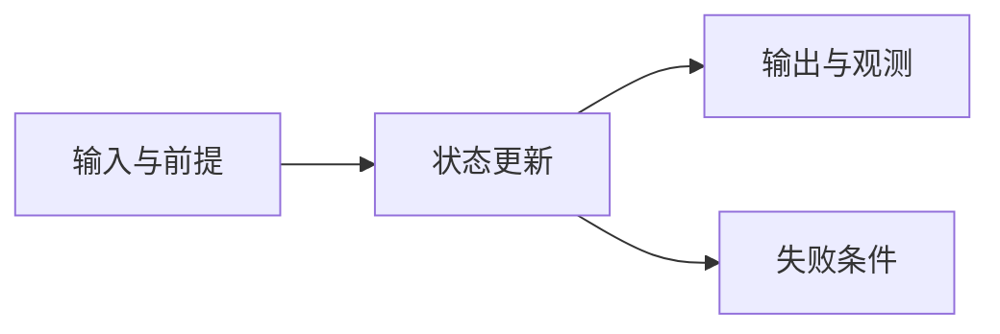

## 问题本质与适用边界

明确现象、约束和适用条件，定义单位、时基与执行上下文。

## 核心机制模型

标出资源所有者，以及发布或释放数据的条件。

## 跨项目实现对比

| 项目 | 约束与机制 | 同步或状态条件 | 可观测证据 |
| --- | --- | --- | --- |
| 关联项目 | 按固定提交填写 | 明确执行上下文 | 度量和引用入口 |

## 可复用模式与常见反模式

用最小 C 伪代码写明状态所有者、单位、失败处理和线程边界。注明代码示例的适用前提。

## 系统化验证用例

| 场景 | 输入或注入条件 | 观测点 | 通过条件 |
| --- | --- | --- | --- |
| 正常、边界与故障 | 可复现刺激 | 源码或仪器测点 | 可判定的预期 |

<!-- HUMAN-NOTES:START -->
## 个人复盘与后续思考
（由人工补充与维护）
<!-- HUMAN-NOTES:END -->
