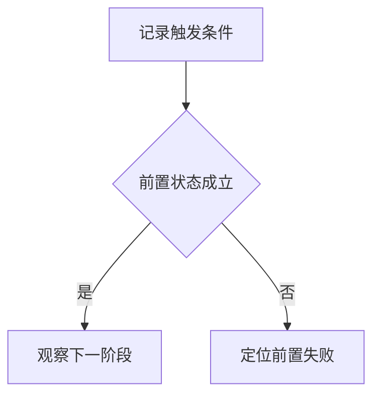

## 典型现象与触发条件

说明可观察现象、固件版本、接线与最小复现条件。附上原始日志关键字和测量时基。

## 错误原因与触发机理

先写清主案例在哪个条件或接口失效。引用可定位的公开记录或固定提交源码。同一现象有其他触发路径时，逐条说明条件和证据来源。

## 定位过程与关键证据

从最早的异常现象出发，按时间或数据流说明排除前序环节的依据。记录决定性日志、时间差、状态值或抓包结果，并指出对应的源码分支。缺少现场记录时，写明这是依据源码整理的定位方法。

## 具体排查流程

### 故障定位决策树

### 分步排查与速查表

| 阶段 | 观测点与日志 | 正常基线 | 异常根因 | 处理 |
| --- | --- | --- | --- | --- |
| 确认触发条件 | 待填写 | 可量化条件 | 按证据定位 | 确认可复现的输入 |
| 验证故障阶段 | 待填写 | 可量化条件 | 按证据定位 | 记录最早偏离基线的测点 |
| 修复后复测 | 待填写 | 可量化结果 | 按证据定位 | 用原输入与正常样本复测 |

## 关键源码测点

列出固定提交链接、变量、单位及上下游对应信号。

## 验证闭环与边界

用相同触发条件复测，记录修复前后变化。补一次可控异常输入，验证流程走到预期失败分支。

> [!WARNING]
> 标明仍需实板或仪器复核的量，以及已有源码、公开记录和实验各自支持的结论。

<!-- HUMAN-NOTES:START -->
## 个人复盘与后续思考
（由人工补充与维护）
<!-- HUMAN-NOTES:END -->
