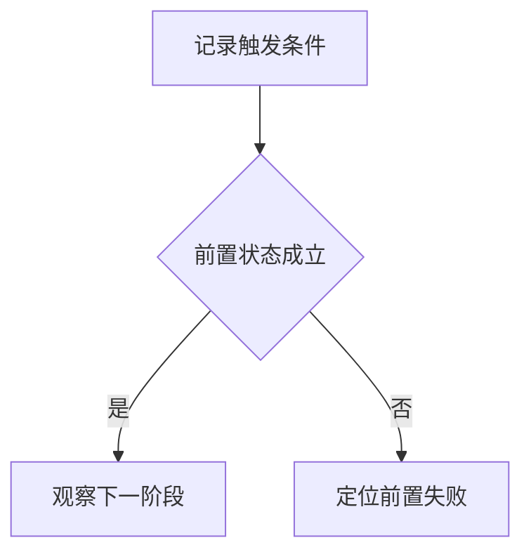

## 典型现象与触发条件

说明可观察现象、固件版本、接线与最小复现条件。附上原始日志关键字和测量时基。

## 故障定位决策树

## 分层排查速查表

| 阶段 | 观测点与日志 | 正常基线 | 异常根因 | 处理 |
| --- | --- | --- | --- | --- |
| 入口 | 待填写 | 可量化条件 | 按证据定位 | 复测步骤 |

## 关键源码测点

列出固定提交链接、变量、单位及上下游对应信号。

## 验证闭环与边界

用相同触发条件复测，记录修复前后变化。标明源码、主机、台架和实板各自支持的结论。

<!-- HUMAN-NOTES:START -->
## 个人复盘与后续思考
（由人工补充与维护）
<!-- HUMAN-NOTES:END -->
