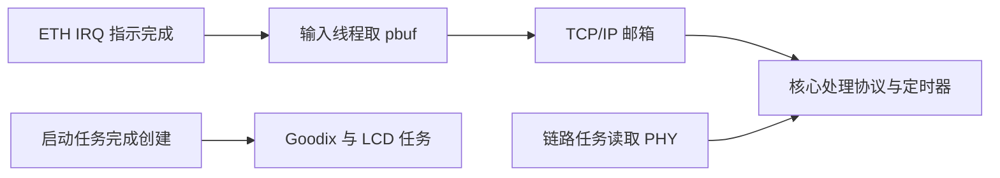

## 背景与硬约束

[[iwip|STM32F407 以太网工程]] 同时运行 Goodix 触摸、NT35510 LCD 画板和网口。若把触摸、可能耗时的 LCD 操作及网络收包放在单循环，任何长事务都进入其他业务的轮询延迟。在当前移植中，图形 BSP 的访问与网络协议核心分别有独立的任务上下文。

| 固定配置 | 数值或能力 | 约束 |
| --- | --- | --- |
| 触摸任务 | 优先级 2，512 字，轮后延时 10 ms | 高网络负载下以实测触摸服务间隔评估 |
| 以太网输入及核心 | `eth_thread` 6 / 512 字，`TCP/IP` 5 / 1024 字 | 输入线程投邮箱，避免把栈调用搬进 ETH 中断 |
| 链路与 DHCP | 链路 3 / 384 字；可选 DHCP 2 / 384 字 | 100 ms / 250 ms 是服务间隔 |
| 堆和邮箱 | FreeRTOS 32 KiB，lwIP 16 KiB，核心邮箱 8 | 预算还含 DMA 缓冲、内存池和任务 TCB |
| API | RAW 可用，`LWIP_NETCONN=1`，`LWIP_SOCKET=0` | socket 需要启用对应选项和构建检查 |

## 决策与落地机制

采用 FreeRTOS 下的 `NO_SYS=0`。`start_task` 初始化 lwIP 和网口、创建触摸与 LED 后自删除。PHY 协商由独立任务轮询。ETH IRQ 用信号量交给输入线程，输入线程把收到的 pbuf 投到 TCP/IP 核心。

RAW 回调在核心执行，跨任务使用核心支持的调用路径，例如 `tcpip_callback` 或 port 允许的核心锁。对单个 socket 或 netconn 对象的并行访问还需核对对应 API 的约束。当前驱动在配置 MAC 和更新 link 标志时使用核心锁，DHCP 状态推进也有同样保护。ISR 只用适配的 RTOS 原语报告事件。

## 备选方案对比

| 方案 | 调度与接口 | 资源与维护代价 | 决策 |
| --- | --- | --- | --- |
| FreeRTOS / `NO_SYS=0` | 收包、协议核心、链路和触摸独立调度，启用 Netconn | RTOS 堆、多个栈和 mailbox，必须核对上下文 | 采纳 |
| 裸机 / `NO_SYS=1` | 主循环处理帧和协议超时，适合单一业务的 RAW API | 协议和 UI 共享节拍，LCD 事务每次都可能拉长处理窗口 | 当前共存负载下未采用 |
| 外部网络协处理器 | MCU 用 SPI/UART 接消息，模块内部持有网络协议 | BOM、模块固件、链路吞吐和诊断接口增加 | 本板已具备 RMII，现阶段未采用 |

## 收益、代价与失效边界

默认常驻网络栈字数为 `1024+512+384=1920`，约 7.5 KiB，仅统计核心、输入、链路三个线程栈。开启 DHCP 另约 1.5 KiB，测试启动峰值再计启动任务栈 2 KiB。这些栈通常来自 32 KiB FreeRTOS 堆，内存预算总表避免重复相加。

TX 4×1536 B 和 RX 10×1536 B 的 payload 合计约 21 KiB，还要加自定义 pbuf 头、DMA 描述符等结构。16 KiB lwIP 堆与通用 pbuf 池也有独立占用。使用链接 map 核对总占用和内部 SRAM 放置，再以运行高水位评估最坏路径。

分线程减小慢 LCD 操作对收包的直接阻碍。长时间网络负载仍可能增加 UI 等待、耗尽 RX 池或填满邮箱。网络回调内长阻塞和持核心锁做慢操作也会影响其他流。若实际内存不够、触摸在可复现负载下持续错过预算，或新产品需要网络与主控故障隔离，可重做调度和模块取舍。

### 复评所需的运行证据

| 负载 | 测量项 | 判定依据 |
| --- | --- | --- |
| 网口空闲、连续触摸 | 任务周期及画板处理时间 | 获得 UI 基线 |
| 同时收包与绘制 | TCP/IP 邮箱高水位、RX 池空闲、触摸 p95 和最大间隔 | 判断阻塞是否随负载跨到另一侧 |
| 插拔网线或 DHCP 回退 | 链路事件、首次有效地址、首个应答 | 复核地址服务的恢复时间 |
| 队列或连接受压 | FreeRTOS 堆最小剩余及线程栈高水位 | 确认剩余 RAM 可支撑最坏并发 |

如果核心邮箱长期积压，结合 RX 池耗尽和应用锁等待时间判断瓶颈，再决定调整驱动、任务或部署。

## 源码证据

- [模式、邮箱和 API](https://github.com/Mangta517/Iwip/blob/eb966f2289c240fd18d5b670aea3057d5f73e3f8/Middlewares/Iwip/arch/lwipopts.h)、[FreeRTOS 适配](https://github.com/Mangta517/Iwip/blob/eb966f2289c240fd18d5b670aea3057d5f73e3f8/Middlewares/Iwip/arch/sys_arch.c)定义执行边界。
- [业务任务调度](https://github.com/Mangta517/Iwip/blob/eb966f2289c240fd18d5b670aea3057d5f73e3f8/application/app_task.c)、[ETH 收包及核心锁](https://github.com/Mangta517/Iwip/blob/eb966f2289c240fd18d5b670aea3057d5f73e3f8/Middlewares/Iwip/arch/ethernetif.c)与 [netif 和 DHCP](https://github.com/Mangta517/Iwip/blob/eb966f2289c240fd18d5b670aea3057d5f73e3f8/Middlewares/Iwip/arch/lwip_comm.c)给出落地机制。
- [历史入口说明](https://github.com/Mangta517/Iwip/blob/eb966f2289c240fd18d5b670aea3057d5f73e3f8/README.md)记录较早的裸机阶段。当前链路与地址的台架核对见 [[ethernet-link-and-ip|以太网分层]] 和 [[TS-0003-ethernet-link-without-ip|网口排障]]。

<!-- HUMAN-NOTES:START -->
## 个人复盘与后续思考
（由人工补充与维护）
<!-- HUMAN-NOTES:END -->
