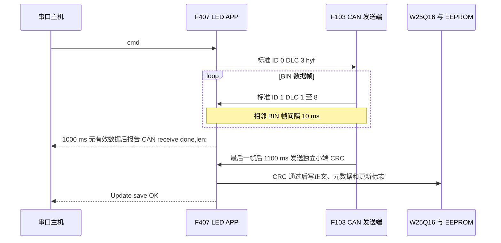
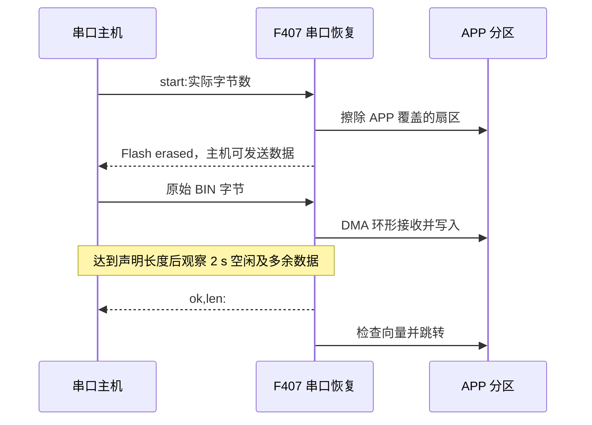

## 项目定位与工程组成

一个 STM32F407VET6 承载三个独立链接目标，STM32F103 提供 CAN 发送端。更换测试 APP 时只部署对应 APP 镜像，主引导和串口恢复保留各自的 Flash 起点。

> [!NOTE] 更新与恢复的源码基线
> 本页对应 `6d5aebc586133f383908581183b44e6572b7be06`。区分 LED APP 的 CAN 缓冲上限和主引导可搬运的分区容量。

| Keil 子工程 | 职责 | 入口或产物 |
| --- | --- | --- |
| `stm32f407vet6` | 上电读取状态、检查外部镜像、搬运与跳转 | [`stm32f407vet6.uvprojx`](https://github.com/Mangta517/bootloader/blob/6d5aebc586133f383908581183b44e6572b7be06/stm32f407vet6/MDK-ARM/stm32f407vet6.uvprojx) |
| `stm32f407vet6reset` | 单独运行的 `USART1` DMA 恢复程序 | [`stm32f407vet6reset.uvprojx`](https://github.com/Mangta517/bootloader/blob/6d5aebc586133f383908581183b44e6572b7be06/stm32f407vet6reset/MDK-ARM/stm32f407vet6reset.uvprojx) |
| `stm32f407vet6led` | 正常 APP，等待 `cmd` 后走 CAN 暂存流程 | [`stm32f407vet6led.uvprojx`](https://github.com/Mangta517/bootloader/blob/6d5aebc586133f383908581183b44e6572b7be06/stm32f407vet6led/MDK-ARM/stm32f407vet6led.uvprojx) |
| `STM32F103CAN` | 等待 `hyf`，从本机片内 Flash 提取 BIN 并发送 | [`STM32F103CAN.uvprojx`](https://github.com/Mangta517/bootloader/blob/6d5aebc586133f383908581183b44e6572b7be06/STM32F103CAN/MDK-ARM/STM32F103CAN.uvprojx) |
| `stm32f407vet6led_blink` | 单灯替换样本，`PE5` 每 500 ms 翻转 | [`stm32f407vet6led_blink.uvprojx`](https://github.com/Mangta517/bootloader/blob/6d5aebc586133f383908581183b44e6572b7be06/stm32f407vet6led_blink/MDK-ARM/stm32f407vet6led_blink.uvprojx) |

## 硬件资源与外设映射

| 资源 | F407 端配置 | F103 或台架侧 |
| --- | --- | --- |
| 系统时钟 | 主引导、恢复、LED APP 用 8 MHz HSE，`SYSCLK` 168 MHz | F103 用 8 MHz HSE，`SYSCLK` 72 MHz；替换 Blink 用 HSI 16 MHz |
| `USART1` | `PA9` TX、`PA10` RX，115200 bit/s、`8N1` | F103 也用 `USART1`，串口装载入口在默认流程中未启用 |
| W25Q16 | `SPI1` `PB3` SCK、`PB4` MISO、`PB5` MOSI；`PB0` 低有效 CS，2 MiB | 文件偏移按字节，页 256 B，扇区 4 KiB |
| 24C02 | `I2C1` `PB6` SCL、`PB7` SDA，7 位地址 `0x50` | 上拉与低电平 WP 需实物确认 |
| `KEY1` | `PE0` / `EXTI0` 设置本次启动恢复请求 | 观察上电检查窗口内的有效边沿 |
| `LED0` / `LED1` | `PE5` / `PE6`，低电平点亮 | 恢复程序 `PE6` 常亮，更新 APP 空闲交替闪烁 |
| bxCAN | LED APP 的 CAN1 `PB8` RX、`PB9` TX；42 MHz / 42 / 5 = 200 kbit/s | F103 `PA11` RX、`PA12` TX，同为 200 kbit/s；两端收发器和终端电阻 |

时钟和复用入口见 [主引导 CubeMX](https://github.com/Mangta517/bootloader/blob/6d5aebc586133f383908581183b44e6572b7be06/stm32f407vet6/stm32f407vet6.ioc)、[LED APP 接线](https://github.com/Mangta517/bootloader/blob/6d5aebc586133f383908581183b44e6572b7be06/stm32f407vet6led/CAN_RECEIVE.md)、[F103 CAN 配置](https://github.com/Mangta517/bootloader/blob/6d5aebc586133f383908581183b44e6572b7be06/STM32F103CAN/CAN_README.md)。

## 架构与执行机制

| F407 区域 | 字节区间，左闭右开 | 扇区 | 容量 | `VTOR` 相对 Flash 基址 |
| --- | --- | --- | --- | --- |
| 主 Bootloader | `[0x08000000, 0x08004000)` | 0 | 16 KiB | `0x0000` |
| 串口恢复 | `[0x08004000, 0x08008000)` | 1 | 16 KiB | `0x4000` |
| APP | `[0x08008000, 0x08080000)` | 2–7 | 480 KiB | `0x8000` |

APP 扇区 2、3 各 16 KiB，4 为 64 KiB，5–7 各 128 KiB。主引导按最后一个镜像字节定位终止扇区，擦除从扇区 2 开始的连续区间。串口恢复按同一 APP 分区部署，恢复入口留在扇区 1。两条更新路径的完成条件和擦除时机不同。[搬运与擦除函数](https://github.com/Mangta517/bootloader/blob/6d5aebc586133f383908581183b44e6572b7be06/stm32f407vet6/application/app_bootloader.c)

主引导依次执行 `App_bootloader_check_default`、`App_bootloader_check_update`、`App_bootloader_update`、`App_bootloader_jump_app`。首步等待 3000 ms，EXTI 回调可以在启动阶段登记恢复请求。USART 命令解析和 CAN 接收在 LED APP 内推进，主引导自身只在复位时消费提交标记。

### EEPROM 状态交接

| `0x10` | `0x11–0x12` | 启动分流 | 后续状态 |
| --- | --- | --- | --- |
| `01` | `5A 6B` | `BOOT_UPDATE`，检查 W25Q16 并更新 | 成功仅写 `0x10=02`；搬运失败保留 `01` 并选恢复入口 |
| `02` | `5A 6B` | `BOOT_NO_UPDATE`，选择内部 APP | 检查内部向量后跳转 |
| `03` | `5A 6B` | `BOOT_RESET`，选择串口恢复区 | 可由 `KEY1` 在 RAM 中设置本次恢复请求 |
| 任意 | 不匹配 | 写入 `01 5A 6B` 并等待 10 ms，RAM 状态维持默认 `02` 或已收到的 `03` | 下次读到有效密钥和 `01` 时才尝试搬运 |

`0x5A6B` 是两字节有效性标记，存储顺序为高字节在前。有效密钥分支在短 `PRIMASK` 保护区内读取状态，保留已有 `KEY1` 请求。若状态字节既非 `01` 也非 `03`，最终跳转选择 APP。主引导的清标记调用无读回确认，LED APP 的提交则会比对全部三个字节。[状态定义](https://github.com/Mangta517/bootloader/blob/6d5aebc586133f383908581183b44e6572b7be06/stm32f407vet6/application/app_bootloader.h)

## 关键协议、存储布局与算法设计

### W25Q16 暂存格式与读取约束

| 字节位置 | 值或作用 | 主引导检查 |
| --- | --- | --- |
| `0x000000–0x000003` | 32 位小端正文起点 | `0x001000 <= start < 0x200000` |
| `0x000004–0x000007` | 32 位小端真实字节数 | `0x0800 < len <= 0x78000`，并且 `len <= 0x200000 - start` |
| `0x001000` 起 | LED APP 当前写入的 BIN 正文 | 先读首 8 B 检查初始 `MSP`、复位入口 |
| 以 4480 B 为例 | 元数据 `00 10 00 00 80 11 00 00` | CRC 和 CRC 计算填充值均不随暂存记录写入 |

LED APP 先擦元数据扇区和正文覆盖扇区，按页写正文，最后发布元数据并读回 EEPROM。主引导将正文分批读入 512 B 静态缓冲。Flash 按小端半字写，只有奇数长度尾块在 RAM 中补一个 `0xFF`，偏移仍按真实字节数前进。外部读取或片内编程失败会退出搬运并选择恢复。

### CAN 更新与 `USART1` 恢复

| CAN 阶段 | 检查 | 失败走向 |
| --- | --- | --- |
| 开始 | USART `IDLE` 收 `cmd`，空闲状态才触发 `hyf` | 其他命令不推进更新 |
| 收 BIN | 标准数据帧 ID 1，DLC 1–8，以实际 DLC 加入 5120 B 缓冲 | 无关帧不刷新时限；溢出、无有效数据转错误 |
| 等 CRC | 1 s 边界先于 FIFO 读取判断，CRC 必须 ID 1 且 DLC 4 | 最后有效数据后 2 s 未通过则清本轮缓存、回空闲 |
| 校验与保存 | CRC 多项式 `0x04C11DB7`、初值 `0xFFFFFFFF`，按小端 32 位字输入，尾字零补齐；保存长度 2049–5120 B | `CRC FAIL` 或 `Update save FAIL` 对应不同阶段 |

F103 当前使用预装的 4480 B 镜像，正常发送 560 个满载数据帧和一个 CRC 帧。更换预装文件时核对 `APP_UPDATE_STORED_SIZE_BYTES`。F103 装载说明记录独立的串口接收流程。[F103 片内装载](https://github.com/Mangta517/bootloader/blob/6d5aebc586133f383908581183b44e6572b7be06/STM32F103CAN/FLASH_RECEIVE.md)

恢复命令允许 1–491520 B。先解析长度再擦除，接收按原始字节流处理。`ok,len:` 之后仍可因向量无效出现 `jump error`。[恢复协议](https://github.com/Mangta517/bootloader/blob/6d5aebc586133f383908581183b44e6572b7be06/stm32f407vet6reset/SERIAL_UPGRADE.md)

## 源码入口与核心调用链

1. [主引导入口](https://github.com/Mangta517/bootloader/blob/6d5aebc586133f383908581183b44e6572b7be06/stm32f407vet6/Core/Src/main.c)初始化后进入检查、更新、跳转，外部校验拒绝与内部跳转失败可在不同阶段观测。
2. [更新状态机](https://github.com/Mangta517/bootloader/blob/6d5aebc586133f383908581183b44e6572b7be06/stm32f407vet6led/application/app_update.c)从 `app_update_work` 进入接收、`app_crc_cal` 和 `app_update_save_image`。成功时保持完成态，复位由外部发起。
3. [F103 CAN 发送](https://github.com/Mangta517/bootloader/blob/6d5aebc586133f383908581183b44e6572b7be06/STM32F103CAN/appliaction/app_update.c)处理 `hyf`、源镜像验证、数据帧逐次发送和延后 CRC。
4. [恢复状态机](https://github.com/Mangta517/bootloader/blob/6d5aebc586133f383908581183b44e6572b7be06/stm32f407vet6reset/application/app_reset.c)解析命令、启动 DMA、收尾并调用恢复工程的跳转接口。
5. [主引导跳转接口](https://github.com/Mangta517/bootloader/blob/6d5aebc586133f383908581183b44e6572b7be06/stm32f407vet6/interface/int_bootloader.c)检查对齐后的 `MSP` 落在 `(0x20000000, 0x20020000]` 或 `(0x10000000, 0x10010000]`，并检查复位向量 Thumb 位及目标分区范围。外部预检查另以实际镜像长度约束入口，检查精度与最终跳转入口不同。

跳转关闭 IRQ，调用 `HAL_DeInit`，清 `SysTick`、NVIC 及系统挂起状态，写 `VTOR` 后做 `DSB` / `ISB`，再切 `MSP` 调目标入口。现有目标入口负责重新开启全局中断，失败时打印落点并留在当前主循环。恢复入口可用时，单独的 `KEY1` 请求可协助确认是搬运失败还是 APP 无法启动。

## 构建方式与验证边界

> [!TIP] 历史构建与联调记录
> [构建与联调记录](https://github.com/Mangta517/bootloader/blob/6d5aebc586133f383908581183b44e6572b7be06/README.md)使用 Keil µVision 5、Arm Compiler 5.06 update 5 build 528。LED APP 的 After Build 工具路径需在异机按安装位置配置。Blink 的旧记录中 1360 B 原始镜像补到 4480 B，当前打包时以实际构建产物为准。

| 验证工具 | 证据对象 |
| --- | --- |
| [`test_bootloader_jump.py`](https://github.com/Mangta517/bootloader/blob/6d5aebc586133f383908581183b44e6572b7be06/stm32f407vet6/tools/test_bootloader_jump.py) | 目标分区与向量拒绝、跳转准备 |
| [`test_update_crc.py`](https://github.com/Mangta517/bootloader/blob/6d5aebc586133f383908581183b44e6572b7be06/stm32f407vet6led/tools/test_update_crc.py) | CRC、帧时限、页/扇区、元数据和提交失败 |
| [`test_uart_ring.py`](https://github.com/Mangta517/bootloader/blob/6d5aebc586133f383908581183b44e6572b7be06/stm32f407vet6reset/tools/test_uart_ring.py) | USART DMA 环形缓存与接收边界 |
| [`test_app_update.py`](https://github.com/Mangta517/bootloader/blob/6d5aebc586133f383908581183b44e6572b7be06/STM32F103CAN/tools/test_app_update.py) 与 [`test_app_flash.py`](https://github.com/Mangta517/bootloader/blob/6d5aebc586133f383908581183b44e6572b7be06/STM32F103CAN/tools/test_app_flash.py) | 发送端和装载路径的独立回归 |
| [`make_update_bin.py`](https://github.com/Mangta517/bootloader/blob/6d5aebc586133f383908581183b44e6572b7be06/stm32f407vet6led_blink/tools/make_update_bin.py) | 目标向量与 4480 B 替换样本 |

各脚本用 Python 3 调用主机 GCC 和模拟桩。Keil 工程分别构建后核对 map 中的链接地址与 BIN 的向量字。主机回归覆盖逻辑路径，实板还需确认擦写电压、收发器、`KEY1` 和启动时序。

> [!WARNING] 掉电与跳转的实板验证
> 分别在提交前、片内擦除后、最后一个半字写入后和清标记时记录掉电点。重启观察状态字、外部元数据、实际跳转分区与 APP 的可运行性。留存更新标志只提示重试，搬运过程中原 APP 可能已被擦除。

## 相关知识

- [[ADR-0001-stage-image-before-boot|外部镜像暂存决策]]
- [[embedded-stream-framing|CAN 与串口组帧]]
- [[TS-0001-bootloader-update-phase|按升级阶段定位故障]]

<!-- HUMAN-NOTES:START -->
## 个人复盘与后续思考
（由人工补充与维护）
<!-- HUMAN-NOTES:END -->
