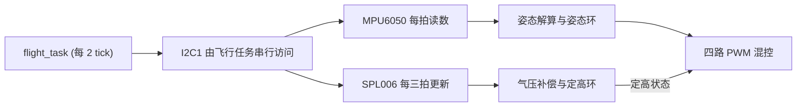
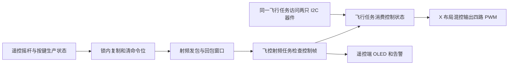

## 项目定位与工程组成

`flight_hal` 和 `flight_remote_hal` 分别构建飞控端和遥控端。两端共享射频帧约定，各自持有输入或输出设备的状态。飞控从 IMU 姿态测量计算电机输出，遥控端产生摇杆和按键命令并显示回包。

> [!NOTE]
> 固定提交源码核对事实。本页采用 `8b05c39baa1731cf4873d2caaa0db34a61b63e2c` 的实际宏和任务体。周期以 1 kHz FreeRTOS tick 换算，代表任务请求的节奏。

| 工程 | 输入 | 输出与入口 |
| --- | --- | --- |
| `flight_hal` | 射频控制帧、MPU6050、SPL006 | TIM2 PWM；[飞控 main](https://github.com/Mangta517/flight/blob/8b05c39baa1731cf4873d2caaa0db34a61b63e2c/flight_hal/Core/Src/main.c) |
| `flight_remote_hal` | 四路摇杆、按键、飞控回包 | SPI2 射频、OLED、蜂鸣器；[遥控 main](https://github.com/Mangta517/flight/blob/8b05c39baa1731cf4873d2caaa0db34a61b63e2c/flight_remote_hal/Core/Src/main.c) |

## 硬件资源与外设映射

| 端 | 资源 | 固件配置 |
| --- | --- | --- |
| 飞控 | MPU6050、SPL006 | I2C1 PB6 SCL / PB7 SDA，400 kHz；7 位地址 `0x68`、`0x77` |
| 两端 | nRF24L01P | SPI2 PB13 SCK、PB14 MISO、PB15 MOSI；PB12 NSS、PA11 EN |
| 飞控 | 电机 PWM | TIM2 四路，PSC=8、ARR=999，位置见混控表 |
| 飞控 | 板载指示与调试 | PB1、PB9 LED；USART3 PB10 TX、PB11 RX |
| 遥控 | 摇杆 | ADC 输入 PA0–PA3；处理函数发布 0–1000 控制量 |
| 遥控 | OLED | I2C1 PB8 SCL、PB9 SDA |
| 遥控 | 按键 | PA6、PA7、PA15、PB11、PC14、PC15 |
| 遥控 | 蜂鸣器 | PA12 `BUZZ`；告警任务读取回包故障位 |

引脚来源为 [飞控 CubeMX](https://github.com/Mangta517/flight/blob/8b05c39baa1731cf4873d2caaa0db34a61b63e2c/flight_hal/flight_hal.ioc)、[遥控 CubeMX](https://github.com/Mangta517/flight/blob/8b05c39baa1731cf4873d2caaa0db34a61b63e2c/flight_remote_hal/filght_remote_hal.ioc)。机械机头、实际电机接线和桨转向需在台架与 PWM 输出对照。

## 架构与执行机制

### 飞行任务与 I2C1

连线表示数据依赖。定高环与气压采样各用一个计数器，循环内的定高计算在本拍气压更新之前。

### 两端任务表

| 端与任务 | 优先级 | 栈字数 | 等待方式 | 职责 |
| --- | --- | --- | --- | --- |
| 飞控 `flight_task` | 3 | 128 | `vTaskDelayUntil` 2 tick | 连接边沿校准、IMU、姿态环、气压分频、混控 |
| 飞控 `led_task` | 1 | 128 | `vTaskDelayUntil` 100 tick | 显示飞控状态 |
| 飞控 `flight_remote_control_task` | 4 | 128 | `vTaskDelay` 10 tick | 射频 RX、回包、连接状态、飞行状态 |
| 飞控 `power_task` | 4 | 128 | `ulTaskNotifyTake` 无限等通知 | 处理开关请求，关断时写四路 CCR 为 0 |
| 遥控 `remote_control_task` | 4 | 128 | `vTaskDelay` 10 tick | 发布摇杆和命令，发包后等待回包 |
| 遥控 `key_get_task` | 3 | 128 | `vTaskDelayUntil` 20 tick | 读取按键事件 |
| 遥控 `joystick_task` | 3 | 128 | `vTaskDelayUntil` 6 tick | ADC 输入与中点处理 |
| 遥控 `oled_task` | 2 | 258 | `vTaskDelayUntil` 80 tick | 画摇杆、连接与姿态 |
| 遥控 `flight_fail_task` | 1 | 128 | `vTaskDelayUntil` 100 tick | 连接且收到故障位时驱动蜂鸣器 |

任务声明见 [飞控任务参数](https://github.com/Mangta517/flight/blob/8b05c39baa1731cf4873d2caaa0db34a61b63e2c/flight_hal/MDK-ARM/application/application_freertos_task.h)、[遥控任务参数](https://github.com/Mangta517/flight/blob/8b05c39baa1731cf4873d2caaa0db34a61b63e2c/flight_remote_hal/MDK-ARM/application/application_freertos_task.h)。飞控在一个任务内串行驱动两只 I2C 器件。SPL006 每三拍更新一次，定高状态的 PID 也每三拍计算，名义间隔 6 ms，两处是独立计数。传感器转换就绪与 I2C 读服务频率分别度量。

遥控侧 `joystick_mutex` 保护写入和整结构读取，发包任务在锁内清一次性命令位。飞控侧射频任务更新 `volatile remote_data_receive`，飞行任务取局部副本，标量和结构成员的读写可分别追踪。当前源码未为飞控端整结构读取建立同一把锁。射频等待和出锁后的 SPI/I2C 事务仍占用各自的执行预算。

## 关键协议、存储布局与算法设计

### 姿态控制、气压定高与限幅

| 控制环 | 输入 → 输出 | Kp / Ki / Kd | 积分限幅 | 输出限幅字段 |
| --- | --- | --- | --- | --- |
| PITCH 外环 | 俯仰角 → Y 角速度目标 | 2.5 / 0 / 0.3 | 5000 | 120 |
| ROLL 外环 | 横滚角 → X 角速度目标 | 2.5 / 0 / 0.3 | 5000 | 120 |
| YAW 外环 | 航向角误差 → Z 角速度目标 | 0.5 / 0 / 0.5 | 5000 | 120 |
| PITCH 内环 | Y 角速度误差 → 俯仰混控量 | 1.5 / 0.5 / 0.18 | 500 | 500 |
| ROLL 内环 | X 角速度误差 → 横滚混控量 | 1.5 / 0.5 / 0.18 | 500 | 500 |
| YAW 内环 | Z 角速度误差 → 偏航混控量 | 0.5 / 0.5 / 0 | 500 | 500 |
| 定高 | 进入定高时的补偿气压 → 公共混控量 | 0.3 / 0 / 0.5 | 5000 | 初始化未设专用值 |

积分和输出字段取自 [PID 初始化](https://github.com/Mangta517/flight/blob/8b05c39baa1731cf4873d2caaa0db34a61b63e2c/flight_hal/MDK-ARM/application/application_flight.c)。任务只在 `NORMAL` 或 `FIX_HEIGHT` 且油门至少 50 时推进姿态 PID；油门低于 50 时最终四路输出清零。解锁进入正常状态以及故障回空闲时重置 PID，低油门仅阻止该循环推进姿态环。定高按压力目标工作，首次 `dt` 取 6 ms，后续按 tick 差换成秒并约束到 5–50 ms。

混控中 `T` 是油门，`P/R` 是俯仰/横滚内环输出，`Y=-gyro_z_pid.output`，`H` 在定高态为定高输出，其余为 0。前电机三个固定补偿宏在该提交都是 0。

| X 布局位置 | PWM | 限幅前表达式 |
| --- | --- | --- |
| 左前 LT | TIM2 CH3 / PA2 | `T + P - R + Y + H` |
| 右前 RT | TIM2 CH2 / PA1 | `T + P + R - Y + H` |
| 左后 LD | TIM2 CH4 / PA3 | `T - P - R - Y + H` |
| 右后 RD | TIM2 CH1 / PA0 | `T - P + R + Y + H` |

> [!WARNING]
> 需实板/仪器验证边界。`APP_FLIGHT_MOTOR_MAX_SPEED=1000` 对应比较量上限。偏航取反依据当前装向调试记录，观察时先拆桨校对通道、方向和 PWM，再解释机体的姿态响应。

### 17 B 射频帧及失联状态

| 字节 | 控制帧含义 | 飞控回包含义 |
| --- | --- | --- |
| 0–2 | ASCII `hyf` | 字节 0 为 `FAIL` 位，1–2 为俯仰角 |
| 3–6 | 两个大端 uint16，油门、偏航 | 两个大端 int16，横滚、偏航 |
| 7–10 | 两个大端 uint16，俯仰、横滚 | 当前回包未填入其他业务字段 |
| 11–12 | 关机翻转命令、定高命令 | 同上 |
| 13–16 | 前 13 B 的简单字节和，大端 uint32 | 回包路径无对应应用层求和 |

姿态回包按度乘 100 后取整。摇杆以 500 为中心，`STICK_DEADZONE=15`；死区和杆量到角度的变换在飞控端。飞控在底层收包成功后尝试回包，随后才判控制帧帧头和求和。遥控端发包成功后最多等 10 ms；飞控以连续 8 次收帧失败触发 `REMOTE_DISCONNECTED` 与 `FAIL`。其墙钟延迟取决于任务、射频重试和轮询开销。定高命令在正常与定高间切换，故障路径回 `IDLE` 并重置积分。

### 零偏与配平

连接从断开转为连接时调用 `my_mpu6050_zero_offset`，此处存在阻塞校准。`IDLE` 时三轴陀螺原始值绝对值均小于 50 才累计静止计数，达到 250 拍后，按 100 个样本求均值并调整零点。按名义 2 ms 计算，250 拍约 500 ms，100 样本约 200 ms，实测还受调度和 I2C 耗时影响。

> [!TIP]
> 历史 README / 调参记录。[调参表](https://github.com/Mangta517/flight/blob/8b05c39baa1731cf4873d2caaa0db34a61b63e2c/README.md)记录了前漂方向、俯仰区间二分和横滚正负值对照。每次实验只改一个配平轴，并记录对应固件与漂移方向。

> [!WARNING]
> 固定提交的 [实际配平宏](https://github.com/Mangta517/flight/blob/8b05c39baa1731cf4873d2caaa0db34a61b63e2c/flight_hal/MDK-ARM/application/application_flight.h) 是 PITCH `2.75f`、ROLL `0.0f`。README 的 `3.0f` 源码描述和 `−7.0°` 试飞记录均为历史值。内环积分限幅以源码的 500 为准。

## 源码入口与核心调用链

- 飞控 `main` 启动 [任务调度](https://github.com/Mangta517/flight/blob/8b05c39baa1731cf4873d2caaa0db34a61b63e2c/flight_hal/MDK-ARM/application/application_freertos_task.c)，`flight_task` 调 [MPU 驱动](https://github.com/Mangta517/flight/blob/8b05c39baa1731cf4873d2caaa0db34a61b63e2c/flight_hal/MDK-ARM/interface/my_mpu6050.c)、[气压驱动](https://github.com/Mangta517/flight/blob/8b05c39baa1731cf4873d2caaa0db34a61b63e2c/flight_hal/MDK-ARM/interface/spl006.c)、串级环、[PWM 接口](https://github.com/Mangta517/flight/blob/8b05c39baa1731cf4873d2caaa0db34a61b63e2c/flight_hal/MDK-ARM/interface/timer_motor.c)。定高 PID 的实际实现位于 `application_flight.c`，另一份 [定高模块](https://github.com/Mangta517/flight/blob/8b05c39baa1731cf4873d2caaa0db34a61b63e2c/flight_hal/MDK-ARM/application/application_fixed_height.c)需结合实际调用判读。
- 遥控 [处理输入](https://github.com/Mangta517/flight/blob/8b05c39baa1731cf4873d2caaa0db34a61b63e2c/flight_remote_hal/MDK-ARM/application/application_process_data.c) → [打包与回包](https://github.com/Mangta517/flight/blob/8b05c39baa1731cf4873d2caaa0db34a61b63e2c/flight_remote_hal/MDK-ARM/application/application_transmit_data.c) → [飞控校验与状态机](https://github.com/Mangta517/flight/blob/8b05c39baa1731cf4873d2caaa0db34a61b63e2c/flight_hal/MDK-ARM/application/application_recevie_data.c) → [遥控 OLED](https://github.com/Mangta517/flight/blob/8b05c39baa1731cf4873d2caaa0db34a61b63e2c/flight_remote_hal/MDK-ARM/application/application_display.c)。
- [射频接口](https://github.com/Mangta517/flight/blob/8b05c39baa1731cf4873d2caaa0db34a61b63e2c/flight_hal/MDK-ARM/interface/nRF24L01P.c)提供收发模式切换和 SPI 寄存器访问。调度周期与射频等待时间可沿两处分别观测。

## 构建方式与验证边界

| 验证层级 | 入口及检查点 |
| --- | --- |
| 飞控构建 | [flight_hal.uvprojx](https://github.com/Mangta517/flight/blob/8b05c39baa1731cf4873d2caaa0db34a61b63e2c/flight_hal/MDK-ARM/flight_hal.uvprojx)，确认 I2C1、TIM2 和 SPI2 初始化均进入目标 |
| 遥控构建 | [filght_remote_hal.uvprojx](https://github.com/Mangta517/flight/blob/8b05c39baa1731cf4873d2caaa0db34a61b63e2c/flight_remote_hal/MDK-ARM/filght_remote_hal.uvprojx)，保留工程文件实际拼写 |
| 主机单测 | [test_application_flight.c](https://github.com/Mangta517/flight/blob/8b05c39baa1731cf4873d2caaa0db34a61b63e2c/flight_hal/MDK-ARM/tests/test_application_flight.c)，检查 IMU/电机初始化次序、参数、独立通道、重复初始化和多余调用 |
| 台架 | 同步记录飞行任务间隔、统计 I2C 超时和射频重试，核对输出范围与失联响应 |
| 实机 | 固定以上版本与配平值，记录漂移、定高偏差及可重复性 |

## 相关知识

- [[task-and-bus-ownership|任务与外设所有权]]
- [[sensor-feedback-pipeline|反馈量、单位与时序]]
- [[ADR-0002-assign-sensor-bus-owner|为传感器总线指定所有者]]

<!-- HUMAN-NOTES:START -->
## 个人复盘与后续思考
（由人工补充与维护）
<!-- HUMAN-NOTES:END -->
