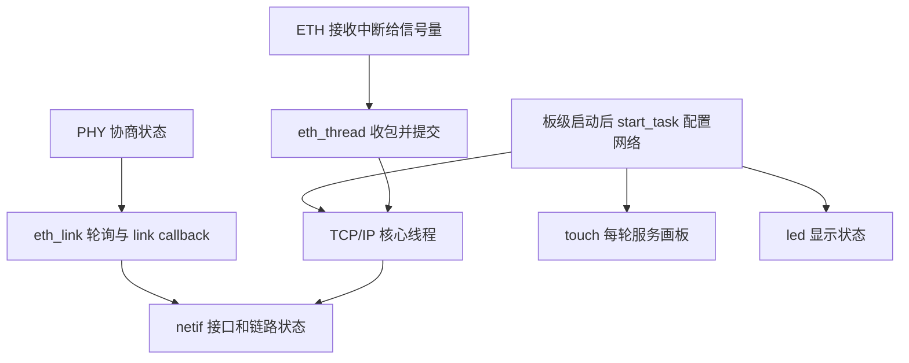
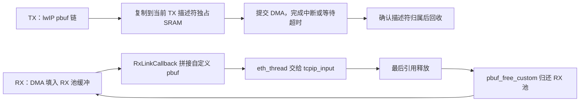

## 项目定位与工程组成

野火霸天虎 V2（STM32F407ZGT6）在 FreeRTOS 下同时运行 lwIP、Goodix 触摸画板和状态灯。Keil 目标、BSP 与 lwIP 移植目录共同确定当前运行模式，LCD、外部存储与网口各保留独立驱动入口。

> [!NOTE]
> 固定提交源码核对事实。以 `eb966f2289c240fd18d5b670aea3057d5f73e3f8` 中的 `main.c`、`app_task.c` 和 `lwipopts.h` 为准。`NO_SYS=0`，网络输入经 `tcpip_input` 提交。

| 路径 | 工程角色 |
| --- | --- |
| `Core/Src` | HAL、时钟和板级启动；随后启动 FreeRTOS |
| `application` | 启动、触摸和 LED 任务 |
| `Drivers/BSP` | LAN8720A、屏幕、触摸、外部存储 |
| `Middlewares/Iwip` | lwIP 内核与 `arch` 下的板级、RTOS 适配 |
| `MDK-ARM` | Keil 目标及链接约束 |

## 硬件资源与外设映射

| 设备 | 接口与实际配置 | 检查点 |
| --- | --- | --- |
| STM32F407ZGT6 | HSE 25 MHz、SYSCLK 168 MHz | 以时钟树和编译目标为准 |
| LAN8720A 时钟与复位 | PA1 接 REFCLKO 50 MHz；nRST 接板级 NRST | MAC 初始化等待 50 ms 后，PHY 驱动走 MDIO 软件复位 |
| LAN8720A 管理接口 | PA2 MDIO、PC1 MDC | 参考地址常量 `0`；初始化扫描 PHY 地址并按 ID 匹配 |
| RMII RX | PA7 CRS_DV，PC4 RXD0，PC5 RXD1 | ETH AF11，DMA 从内置 SRAM 获取缓冲 |
| RMII TX | PG11 TX_EN、PG13 TXD0、PG14 TXD1 | ETH AF11，MAC 速率/双工按 PHY 状态重配 |
| NT35510 | FSMC NE3，命令 `0x68000000` / 数据 `0x68000002` | 独立于 SRAM 片选时序 |
| Goodix GT5xx | 软件 I2C PD7 SCL、PD3 SDA；PD6 RST、PG8 INT | 复位时 INT 低选择 `0x5D`，总线接口传 `0xBA` |
| 外部 SRAM | FSMC NE4 / PG12，`0x6C000000`，1 MiB | 文件保留 `bsp_sdram` 名称，实际使用静态存储控制器 |
| W25Q128 | SPI1 PB3/4/5，PG6 CS | BSP 提供字库路径，`0x4E6000` 为中文资源起点 |

固定配置入口 [ETH 引脚](https://github.com/Mangta517/Iwip/blob/eb966f2289c240fd18d5b670aea3057d5f73e3f8/Drivers/BSP/ETHERNET/ethernet.h)、[PHY 识别和协商](https://github.com/Mangta517/Iwip/blob/eb966f2289c240fd18d5b670aea3057d5f73e3f8/Drivers/BSP/ETHERNET/ethernet_chip.c)、[触摸引脚](https://github.com/Mangta517/Iwip/blob/eb966f2289c240fd18d5b670aea3057d5f73e3f8/Drivers/BSP/touch/bsp_i2c_touch.h)、[SRAM 映射](https://github.com/Mangta517/Iwip/blob/eb966f2289c240fd18d5b670aea3057d5f73e3f8/Drivers/BSP/sdram/bsp_sdram.h)。

## 架构与执行机制

| 上下文 | 优先级 / 栈字数 | 等待方式 | 工作内容 |
| --- | --- | --- | --- |
| `start_task` | 4 / 512 | 网络初始化失败最多尝试 3 次，间隔 500 ms | 创建业务任务后自删除 |
| `TCP/IP` | 5 / 1024 | mailbox | lwIP 核心线程，执行输入和网络定时器 |
| `eth_thread` | 6 / 512 | 等二值 RX 信号量 | 调 `HAL_ETH_ReadData`，将 pbuf 交给 `netif->input` |
| `eth_link` | 3 / 384 | 每轮后延时 100 ms | 读 PHY、设置 MAC 链路、触发 link callback |
| `eth_dhcp` | 2 / 384 | 每轮后延时 250 ms | `LWIP_DHCP=1` 才创建，推进地址状态 |
| `touch` | 2 / 512 | 每轮后延时 10 ms | GT5xx 采样并更新画板 |
| `led` | 1 / 256 | 每轮后延时 500 ms | 显示初始化及链路状态 |

应用栈由 `xTaskCreate` 的字深度指定，lwIP 移植的 `LWIP_FREERTOS_THREAD_STACKSIZE_IS_STACKWORDS=1`，网络线程也按字。ETH IRQ 优先级 6，用 `FromISR` 信号量接口唤醒线程；此数值属于 NVIC 优先级体系。[应用线程](https://github.com/Mangta517/Iwip/blob/eb966f2289c240fd18d5b670aea3057d5f73e3f8/application/app_task.c) [lwIP 线程移植](https://github.com/Mangta517/Iwip/blob/eb966f2289c240fd18d5b670aea3057d5f73e3f8/Middlewares/Iwip/arch/sys_arch.c)

## 关键协议、存储布局与算法设计

### lwIP 与 DMA 内存配置

| 参数 | 当前值 | 含义 |
| --- | --- | --- |
| `NO_SYS` / `SYS_LIGHTWEIGHT_PROT` | 0 / 1 | OS 模式及轻量保护 |
| `LWIP_DHCP` / `LWIP_NETCONN` / `LWIP_SOCKET` | 0 / 1 / 0 | 默认静态地址，启用 Netconn |
| `MEM_SIZE` / `MEM_ALIGNMENT` | 16 KiB / 4 B | lwIP 堆 |
| `MEMP_NUM_PBUF` / `PBUF_POOL_SIZE` / `PBUF_POOL_BUFSIZE` | 10 / 8 / 1524 B | lwIP 自己的 pbuf 头与数据池配置 |
| `MEMP_NUM_TCP_PCB` / `MEMP_NUM_UDP_PCB` | 10 / 6 | 连接控制块池 |
| `TCPIP_MBOX_SIZE` / `MEMP_NUM_TCPIP_MSG_INPKT` | 8 / 8 | 核心邮箱深度与输入消息池 |
| `ETH_RX_DESC_CNT` / `ETH_TX_DESC_CNT` | 4 / 4 | HAL ETH 头的描述符默认数量 |
| `ETH_RX_BUFFER_CNT` / `ETH_RX_BUFFER_SIZE` | 10 / 1536 B | 驱动自定义 RX 池，独立于 lwIP 通用池 |
| `configTOTAL_HEAP_SIZE` | 32 KiB | FreeRTOS `heap_4`，另计于 lwIP 堆 |

描述符、RX 自定义池和每个 TX 描述符的独占缓冲须放在 ETH DMA 可达的内部 SRAM。`0x10000000` 起的 CCM 与外部 SRAM 各有不同的总线访问条件。TX 将 pbuf 链合并，再交 DMA；等待上限 20 ms 后仍通过描述符 OWN / `PacketAddress` 约束复用。RX 将 DMA 缓冲包装成 `pbuf_custom`，由引用释放回调归还自定义池，空池恢复时可重新唤醒 RX 处理。

IP、TCP、UDP、ICMP 的软件校验生成/检查关闭，源码配置 MAC 校验与 TX 硬件插入。接收验证还要看 HAL 错误码及实际包，不能从配置值推出每条线缆上的观测。

### 静态地址与 DHCP 状态流

| 阶段 | 当前配置或状态 | 接口行为 |
| --- | --- | --- |
| 静态默认 | `192.168.1.30 / 255.255.255.0`，网关 `192.168.1.1` | 地址由 `lwip_comm_default_ip_set` 填充，`remoteip` 为 `192.168.1.134` |
| DHCP 已编入，链路 up | `START → WAIT_ADDRESS` | 清空地址并调用 `dhcp_start`，状态 `1` |
| 租约到达 | `ADDRESS_ASSIGNED` | 同步 IP / 掩码 / 网关，状态 `2` |
| 重试超过上限 | `dhcp->tries > 4` | 停 DHCP，恢复静态地址，状态 `0xFF` |
| 链路 down | `LINK_DOWN → OFF` | 停 DHCP、清地址，等下次链路事件 |

`netif_set_up` 是接口管理状态。PHY 协商成功且 MAC 启动后才调用 `netif_set_link_up`。地址、链路和接口三组状态在 `g_lwipdev` 与 `g_lwip_netif` 分别核对。DHCP 检查周期是轮询间隔，重试阈值不能乘以 250 ms 直接推得租约超时。

## 源码入口与核心调用链

1. [main.c](https://github.com/Mangta517/Iwip/blob/eb966f2289c240fd18d5b670aea3057d5f73e3f8/Core/Src/main.c) 初始化板级 SRAM、LCD、画板与触摸，移交 `App_Task_Create/Start`。
2. `app_start_task →` [lwip_comm_init](https://github.com/Mangta517/Iwip/blob/eb966f2289c240fd18d5b670aea3057d5f73e3f8/Middlewares/Iwip/arch/lwip_comm.c) `→ tcpip_init → netif_add`，以 `ethernetif_init` 注册驱动，以 `tcpip_input` 注册输入。
3. [MAC 初始化](https://github.com/Mangta517/Iwip/blob/eb966f2289c240fd18d5b670aea3057d5f73e3f8/Drivers/BSP/ETHERNET/ethernet.c)建描述符环，[PHY 寄存器](https://github.com/Mangta517/Iwip/blob/eb966f2289c240fd18d5b670aea3057d5f73e3f8/Drivers/BSP/ETHERNET/ethernet_chip.h)定义 ID 和协商结果，[以太网适配](https://github.com/Mangta517/Iwip/blob/eb966f2289c240fd18d5b670aea3057d5f73e3f8/Middlewares/Iwip/arch/ethernetif.c)注册 RX/TX 回调。
4. [GT5xx](https://github.com/Mangta517/Iwip/blob/eb966f2289c240fd18d5b670aea3057d5f73e3f8/Drivers/BSP/touch/gt5xx.c)通过 [软件 I2C](https://github.com/Mangta517/Iwip/blob/eb966f2289c240fd18d5b670aea3057d5f73e3f8/Drivers/BSP/touch/bsp_i2c_touch.c)取触点，由 [画板](https://github.com/Mangta517/Iwip/blob/eb966f2289c240fd18d5b670aea3057d5f73e3f8/Drivers/BSP/touch/palette.c)绘制到 [NT35510](https://github.com/Mangta517/Iwip/blob/eb966f2289c240fd18d5b670aea3057d5f73e3f8/Drivers/BSP/lcd/bsp_nt35510_lcd.c)。
5. [FSMC SRAM](https://github.com/Mangta517/Iwip/blob/eb966f2289c240fd18d5b670aea3057d5f73e3f8/Drivers/BSP/sdram/bsp_sdram.c)和 [SPI 字库存储](https://github.com/Mangta517/Iwip/blob/eb966f2289c240fd18d5b670aea3057d5f73e3f8/Drivers/BSP/flash/bsp_spi_flash.c)提供板级资源。

## 构建方式与验证边界

Keil 入口为 [lwip.uvprojx](https://github.com/Mangta517/Iwip/blob/eb966f2289c240fd18d5b670aea3057d5f73e3f8/MDK-ARM/lwip.uvprojx)。复核编译清单及链接 map 中的 DMA 对象地址，确认 `lwipopts.h` 与实际编译宏一致。应用侧用 `[ETH]` 和 `[NET]` 日志分辨初始化、链路及地址状态，再对照 PHY 和抓包。

> [!TIP]
> 历史 README / 移植记录。[BSP 与旧联调说明](https://github.com/Mangta517/Iwip/blob/eb966f2289c240fd18d5b670aea3057d5f73e3f8/README-lwIP.md)记录接线、内存和早期启动方式。当前入口、调用上下文及重试流程以本页列出的代码为准。

> [!WARNING]
> 版本演进与实板边界。顶层 [README](https://github.com/Mangta517/Iwip/blob/eb966f2289c240fd18d5b670aea3057d5f73e3f8/README.md) 保留旧裸机阶段背景，当前为 FreeRTOS + `NO_SYS=0`。网口指示灯、RMII 50 MHz、ARP 响应、DHCP 租约和触摸并发负载都需台架独立确认。

## 相关知识

- [[ADR-0003-run-lwip-in-rtos-mode|lwIP OS 模式决策]]
- [[ethernet-link-and-ip|链路到 IPv4 的分层]]
- [[TS-0003-ethernet-link-without-ip|链路正常但无 IP 排障]]
- [[task-and-bus-ownership|任务、中断与缓冲所有权]]

<!-- HUMAN-NOTES:START -->
## 个人复盘与后续思考
（由人工补充与维护）
<!-- HUMAN-NOTES:END -->
