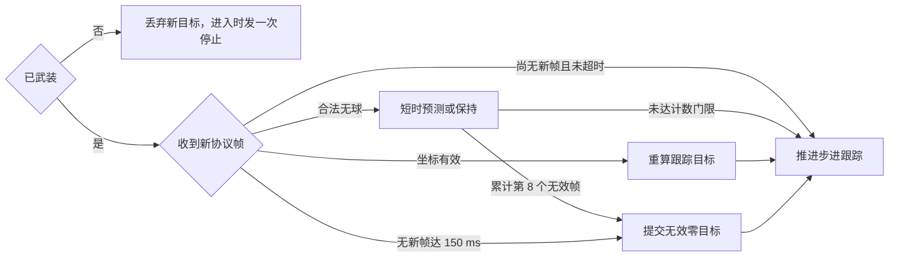

## 项目定位与工程组成

MSPM0G3507 用裸机主循环消费 K230 钢珠坐标，运行平衡 PID，并经 Emm_V5 串口控制摆杆。K230 脚本负责视觉识别及像素编码。源码还保留直流电机、循迹、云台和调参等模块，是否参与默认路径由入口和编译条件决定。

> [!NOTE] 平衡工程的源码基线
> 本页以 `d0232ccc9a7e31693e8fa0d1f234f242cd282856` 为基线。入口文件实际拼写为 `mian.c`。

| 构建或执行入口 | 任务 |
| --- | --- |
| [CCS 工程描述](https://github.com/Mangta517/MSPM0G3507/blob/d0232ccc9a7e31693e8fa0d1f234f242cd282856/.ccsproject)、[编译配置](https://github.com/Mangta517/MSPM0G3507/blob/d0232ccc9a7e31693e8fa0d1f234f242cd282856/.cproject) | CCS / TI Arm Clang，Cortex-M0+ 工程 |
| [SysConfig](https://github.com/Mangta517/MSPM0G3507/blob/d0232ccc9a7e31693e8fa0d1f234f242cd282856/main.syscfg) | MSPM0G3507 LQFP-64(PM)，SDK 2.05.01.00，SysConfig 1.24.0 |
| [`mian.c`](https://github.com/Mangta517/MSPM0G3507/blob/d0232ccc9a7e31693e8fa0d1f234f242cd282856/mian.c) | `SYSCFG_DL_init`、毫秒时基和各应用模块 |
| [K230 视觉入口](https://github.com/Mangta517/MSPM0G3507/blob/d0232ccc9a7e31693e8fa0d1f234f242cd282856/k230_ball_balance.py) | K230 侧检测区域过滤、坐标归一化与串口发送 |

## 硬件资源与外设映射

| 配置实例 | MCU 引脚 / 参数 | 用途 |
| --- | --- | --- |
| `UART_0` | `UART0` TX `PA10` / RX `PA11`，115200 bit/s | K230 收发，视觉输入组帧 |
| `UART_2` | `UART2` TX `PB15` / RX `PB16`，SysConfig 115200 bit/s，入口改为 19200 bit/s | JY901S 初始化，默认轮询停用 |
| `UART_1` | `UART1` TX `PA8` / RX `PA9`，115200 bit/s、FIFO | Emm_V5 TTL，位置命令与回执 |
| `UART3` | `PB12` TX / `PB13` RX，115200 bit/s | 由 `bsp_uart2_proto.c` 手工配置，供无线调参 |
| `SysTick` | `CPUCLK_FREQ / 1000` | 毫秒 tick，主循环消费及看门狗检查 |
| `PA12` | 上拉输入，按下低电平 | 重新武装、发送 K230 `HOME` 命令 |
| `PA13` | 上拉输入，按下低电平 | 解除武装，进入一次性停机分支 |
| `I2C1` / `I2C0` | `PB2` SCL / `PB3` SDA；`PA1` SCL / `PA0` SDA | 板级 OLED 及其他 I2C 设备配置 |
| PWM / 电机 GPIO | PWM 引脚 `PB17`、`PA16`、`PA26`；另有方向及循迹 GPIO | 保留的轮式电机及脉冲测试资源 |

配置表使用 SysConfig 的实例名称与建议映射。部分注释写 `UART1` 或 `UART3`，应结合驱动实际引用的 `UART_*_INST` 解读。[毫秒时基](https://github.com/Mangta517/MSPM0G3507/blob/d0232ccc9a7e31693e8fa0d1f234f242cd282856/MSPM0/clock.c) [步进电机串口驱动](https://github.com/Mangta517/MSPM0G3507/blob/d0232ccc9a7e31693e8fa0d1f234f242cd282856/interface/emmv5.c)

## 架构与执行机制

| 入口或模块 | 基线状态 | 运行边界 |
| --- | --- | --- |
| `STEPPER_SPIN_TEST` | `0` | 默认走 K230 平衡分支，脉冲单测分支保留 |
| `EMMV5_SPIN_TEST` | `0` | 位置往返测试未启用 |
| `g_system_armed` | 全局初值 `false`，初始化结束时设为 `true` | 上电后有数据即可跟踪，`PA12` 可重武装，`PA13` 可取消 |
| `app_stepper_track` | 默认跟踪路径 | 机械限幅、位置命令及回执 |
| `app_line_follow`、`track` | 保留初始化及循迹代码 | 循迹业务分支受 `#if 0` 控制 |
| `app_gimbal_track`、`lock` | 保留云台/锁相关模块 | 当前 `main` 的平衡环不通过该路径 |
| `pid_tuning`、`bsp_uart2_proto` | 主循环消费调参命令 | 参数用于本地 PID，运行时可改 |
| `stall_protect` | 轮式编码电机逻辑保留 | 初始化不代表步进跟踪依赖该模块 |
| `common_filter` | 通用滤波模块 | 平衡路径的球速低通可从 `mian.c` 直接定位 |

`UART0_Proto_Poll` 在主循环持续处理输入，只有武装分支消费 `fresh`、更新最近有效协议帧时间，并推进 `StepperTrack_Update`。全局初值与初始化后的值必须分开观察。调参、显示和协议服务共享循环，因此 1 ms tick 只是时基，平衡输出间隔取决于视觉帧和循环开销。

## 关键协议、存储布局与算法设计

### K230 像素协议和解析

| 线上输入 | 解析结果 | 上层交接 |
| --- | --- | --- |
| `$400,240#` | ASCII 十进制 `cx,cy`；左上为原点，`x` 向右为正，`y` 向下为正 | `fresh=1, valid=1`；有效范围为 `x` 取 0–799、`y` 取 0–479 |
| `$-1,-1#` | 正常发布无球状态 | `fresh=1, valid=0`；武装时同样刷新最近帧时间 |
| `$400,240,100#` | 兼容可选第三字段，范围 ±90000 mdeg | 保留传入角记录，默认控制用 `cx` 重算目标 |
| 分隔或范围错误 | 丢帧并累加解析错误 | 无新数据提交，旧帧的有效位不等于新鲜 |
| 超长、环溢出或二次 `$` | 当前组帧重置或同步至新帧头 | 看溢出与解析计数，再验证下一合法帧 |

K230 将检测框中心映射到 800×480，串口以 `#` 结束。脚本检测到无球发送成对的 `-1`。MCU RX 中断入 128 B 环形队列，任务式轮询解析十进制字段；收到一个合法帧后发布整个状态。`fresh` 是待消费标志，`valid` 是业务值。对照 [历史 K230 接口](https://github.com/Mangta517/MSPM0G3507/blob/d0232ccc9a7e31693e8fa0d1f234f242cd282856/interface/bsp_k230_uart.c) 与 [默认解析入口](https://github.com/Mangta517/MSPM0G3507/blob/d0232ccc9a7e31693e8fa0d1f234f242cd282856/interface/bsp_uart0_proto.c)时，以 `mian.c` 的实际调用为准。

### 从坐标到 Emm_V5

| 环节 | 固定提交参数或算法 | 单位 |
| --- | --- | --- |
| 误差 | `cx - 400`，显示 `cy` 仅供观测 | px |
| 球速 | 差分时间 `dt` 大于 0 ms 且小于 1000 ms，限幅 ±2，低通系数 0.15 | px/ms |
| 增益调度 | 50 px 内从近区到远区线性插值，近区 `Kp=0.70,Kd=0.15`；远区 `8.5,0.60`，`Ki=0.8` 来自 `PIDTune_Init` | 本地 PID |
| 前馈 | `vx_filtered` × 8 ms × `Kp_eff` | mdeg 控制量 |
| 控制输出 | 调参默认 ±3500 mdeg，60 % 以上压缩，误差 8–50 px 可施加 500 mdeg 破静摩擦量；每有效帧最大步长 550 mdeg | mdeg |
| 跟踪输出 | 摆杆 ±10000 mdeg，换算系数 `6400 / (360 × 1000)`；脉冲再限制 ±200，位置命令间隔至少 10 ms | 摆杆 mdeg / 电机轴脉冲 |

PID 先用原始坐标，前馈随后叠加。`mian.c` 顶部的部分宏在有效分支再次定义，分析近期输出时应读使用位置的最终值。`StepperTrack` 接收候选角，把电机已命令的位置、启动读回的实际零点和实时回复分开保存。[启动参数](https://github.com/Mangta517/MSPM0G3507/blob/d0232ccc9a7e31693e8fa0d1f234f242cd282856/application/pid_tuning.c) [PID 实现](https://github.com/Mangta517/MSPM0G3507/blob/d0232ccc9a7e31693e8fa0d1f234f242cd282856/common/pid.c) [跟踪实现](https://github.com/Mangta517/MSPM0G3507/blob/d0232ccc9a7e31693e8fa0d1f234f242cd282856/application/app_stepper_track.c)

| Emm_V5 帧 | 主要字段 | 固件处理 |
| --- | --- | --- |
| `0xFD` 位置，13 B | 地址、命令、方向、速度 `BE16`、加速度、脉冲 `BE32`、绝对位 `1`、同步位、`0x6B` | 地址默认为 1 |
| 短回执，4 B | 地址、功能、状态、`0x6B` | `02` 接受，`9F` 到位，`E2/EE` 锁存错误 |
| `0x36` 位置读取应答，8 B | 地址、功能、符号、`BE32`、`0x6B` | 按已知长度接收；Emm 回读角度按 `360000 / 65536` 换算为 mdeg |
| `0xFE` 停止，5 B | 地址、`FE 98`、同步位、`6B` | 未武装或驱动故障路径使用 |

### 丢球、超时和保护状态

合法无球帧会刷新最近帧时间。无球计数和串口帧超时分别判断，均可提交回中目标。

| 触发 | 当前代码动作 | 恢复或证据 |
| --- | --- | --- |
| 持续合法无球帧 | 可按最后速度短预测，最长 160 ms；第 8 个连续无效帧清 PID 与历史，置无效零目标 | 看无球帧计数，下一有效帧重新计算 |
| 150 ms 无成功解析并消费的新帧 | `g_k230_timeout=true`，调用 `StepperTrack_SetTarget(0,false)` 并继续跟踪更新 | 下一协议帧清超时；路径产生回中目标 |
| `PA13` 解除武装 | 丢弃新目标，调用一次 `StepperTrack_EmergencyStop` | `PA12` 重武装；记录实际 `FE` 帧 |
| Emm `E2/EE` | 跟踪层锁存 `fault`、清目标并发送停止 | 由显式重武装重新使能，不能只看视觉帧 |
| 编码直流电机堵转 | `common/stall_protect.c` 按占空比与编码脉冲判定，常量为 10 %、2 s、冷却 3 s | 与 Emm 回执故障属于不同执行器路径 |

> [!TIP] 历史武装与丢球门限
> 头部注释描述先按键开始以及较早的 3 帧丢球门限。当前入口上电初始化后自动武装，实际丢球分支按 8 帧以及独立的时间限制执行。

## 源码入口与核心调用链

1. `mian.c → SYSCFG_DL_init → SysTick_Init → UART0_Proto_Init → StepperTrack_Init`，再进入主循环。
2. `UART0_Proto_Poll → uart0_process_byte → uart0_parse_frame → g_uart0_data`，审计边界时从 `fresh` 追到时间更新点。
3. `Common_PID_Calc → StepperTrack_SetTarget → StepperTrack_Update → EMMV5_PositionSigned → EMMV5_RX_Poll`。看角度变化就追位置帧，看无动作则追武装、故障和倍率。
4. [循迹](https://github.com/Mangta517/MSPM0G3507/blob/d0232ccc9a7e31693e8fa0d1f234f242cd282856/application/app_line_follow.c)、[云台](https://github.com/Mangta517/MSPM0G3507/blob/d0232ccc9a7e31693e8fa0d1f234f242cd282856/application/app_gimbal_track.c)、[锁控制](https://github.com/Mangta517/MSPM0G3507/blob/d0232ccc9a7e31693e8fa0d1f234f242cd282856/application/lock.c)、[通用滤波](https://github.com/Mangta517/MSPM0G3507/blob/d0232ccc9a7e31693e8fa0d1f234f242cd282856/common/common_filter.c)与 [编码器堵转保护](https://github.com/Mangta517/MSPM0G3507/blob/d0232ccc9a7e31693e8fa0d1f234f242cd282856/common/stall_protect.c)为同仓可参考模块。

## 构建方式与验证边界

CCS 导入目标后配置相匹配的 SDK 和 SysConfig，生成 `ti_msp_dl_config.c/.h`。固定提交静态审计看到 SysConfig 与 XDS110 目标配置，生成文件和可烧录文件需在构建后获取。K230 脚本、模型和显示尺寸需在视觉设备侧配套部署。

> [!WARNING] 回中与停机的实板验证
> 分别记录 K230 发帧、MSPM0 目标毫度、`UART1` 位置命令与回执，并核对电机固件、绝对坐标零点、限位和方向。测试无球、断链和 `PA13` 时分别记录回中、停止和锁存状态。

## 相关知识

- [[embedded-stream-framing|UART 流重组与状态有效性]]
- [[sensor-feedback-pipeline|像素到执行器的单位链]]
- [[TS-0004-k230-vision-timeout|视觉丢失、超时与回执排障]]

<!-- HUMAN-NOTES:START -->
## 个人复盘与后续思考
（由人工补充与维护）
<!-- HUMAN-NOTES:END -->
