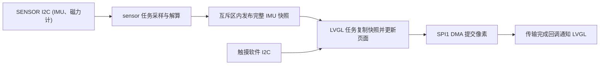
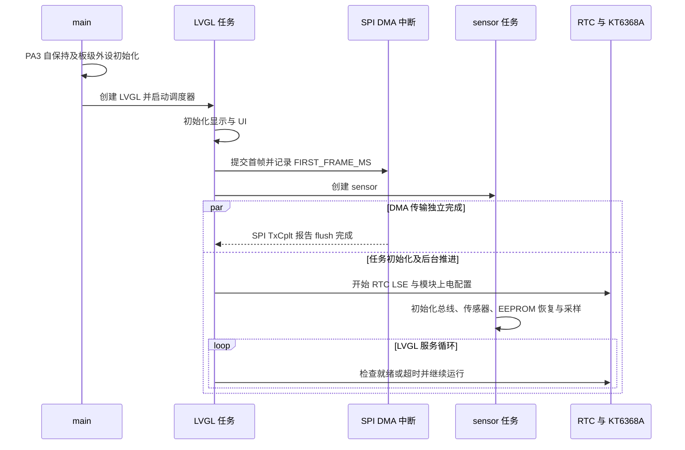

## 项目定位与工程组成

STM32F411CEU6 上同时运行 LVGL 界面、环境与运动传感器、RTC、蓝牙和电源管理。设备端通过 KT6368A 输出诊断帧，手机调试器解析帧并导出 CSV。固件可分析从供电到首帧、采样和后台模块就绪的事件序列。

> [!NOTE] 启动诊断的源码基线
> 本页以 `fbd89280178acf4a51e80f919e7f96468b4967f0` 为基线。启动字段取自实际 `app_diag.h`，屏幕 DMA 完成和可见首帧另外测量。

## 硬件资源与外设映射

| 设备 | MCU 资源 | 配置与职责 |
| --- | --- | --- |
| ST7789 LCD | `SPI1` `PB3` SCK / `PB5` MOSI；`DMA2` `Stream2` Channel 2 | `PB7` 复位、`PB8` 片选、`PB9` DC；`PB0` `TIM3` `CH3` 背光；240×280 |
| CST816 触摸 | `PB6` SCL / `PB4` SDA，`PA15` 复位 | 探测 7 位地址 `0x15` 与 `0x14`；LVGL 输入路径 |
| MPU6050 | SENSOR 软件 I2C，`PB14` SCL / `PB13` SDA；`PB12` EXTI | `0x68`；±4 g、±1000 °/s，100 Hz 配置 |
| LSM303DLHC 磁力计 | SENSOR I2C | `0x1E`；75 Hz 连续转换，读 `DRDY` 后取 X/Z/Y 原始数据 |
| SPL006 气压计 | SENSOR I2C | `0x76`；器件 1 Hz，任务每 250 ms 检查就绪 |
| AHT21 温湿度 | SENSOR I2C | `0x38`；约 2 s 触发一轮，跨循环等待转换 |
| EM7028 心率 | SENSOR I2C；`PB15` 照明控制 | `0x24`；开启心率后按 30 ms 软件下限读取 |
| BL24C02 | 独立软件 I2C，`PA12` SCL / `PA11` SDA | `0x50`，256 B、16 B 页；保存两类校准数据 |
| KT6368A | `USART1` `PA9` TX / `PA10` RX，`PA8` 电源使能 | 115200 bit/s，UART RX 中断，启动配置与异步诊断发送 |
| 电池 | `ADC1` `PA1` | 每 1000 ms 服务读数，启动阶段发布一次 |
| RTC | LSE `PC14` / `PC15` | 由 LVGL 任务推进就绪和配置 |
| 电源与按键 | `PA3` 自保持、`PA4` WAKE、`PA5` `KEY_1` | 主入口尽早拉高 `PA3` |

复用和默认电平见 [CubeMX 配置](https://github.com/Mangta517/watch/blob/fbd89280178acf4a51e80f919e7f96468b4967f0/f411ceu6.ioc)、[引脚宏](https://github.com/Mangta517/watch/blob/fbd89280178acf4a51e80f919e7f96468b4967f0/Core/Inc/main.h)。三个软件 I2C 用途分别是触摸、SENSOR 和 EEPROM，抓波形时需先确认总线。

## 架构与执行机制

### 从姿态快照到屏幕

这条显示链通过快照交接姿态。总线采样和计算在快照互斥区之外，触摸与显示由 LVGL 一侧处理。

| 任务 | 优先级 / 栈 | 调度 | I/O 与交接 |
| --- | --- | --- | --- |
| `lvgl` | 3 / 1024 字 | 每轮服务后 `vTaskDelay` 5 ms | 独占 LVGL 与触摸，消费各应用快照，推进 RTC/蓝牙及诊断 |
| `sensor` | 2 / 512 字 | `vTaskDelayUntil` 10 ms | 独占 SENSOR 总线，推进 IMU、磁校准、心率、环境及电池 |
| 内核 `IDLE` | 由内核创建 | 可运行时 | 用于诊断 CPU 统计，任务创建表仍为上述两项应用任务 |

MPU 和磁力计随每拍服务，低频气压使用 25 拍计数。AHT21、心率和电池由各应用模块按毫秒计时。`App_IMU_Service` 生产 `app_imu` 快照，互斥保护结构体的短读写，采样、计算和慢速保存留在锁外。磁力计数据包含机体坐标场强、校准和参考状态。UI 经快照读取姿态、传感器值与有效位，蓝牙业务及诊断用各自缓冲。

`lv_refr_now(NULL)` 返回后记首帧提交，随后立即创建 `sensor`，代码无等待 DMA 回调的门槛。图中 DMA 分支表达独立完成关系，回调可能在创建前后出现。电源锁存、真实 SPI 传输结束与面板可见刷新都是独立测点。[任务与事件](https://github.com/Mangta517/watch/blob/fbd89280178acf4a51e80f919e7f96468b4967f0/application/app_task.c) [LCD DMA 完成回调](https://github.com/Mangta517/watch/blob/fbd89280178acf4a51e80f919e7f96468b4967f0/interface/lcd.c)

## 关键协议、存储布局与算法设计

### BL24C02 校准记录

| 记录 | 槽位与预留 | 实际记录格式 | 加载及更新 |
| --- | --- | --- | --- |
| MPU `MPU1` | `0x60` / `0x80`，各 32 B | 28 B，小端标识、序号、量程、六个 `int16` 零偏、CRC32 | 校验 CRC 与量程，恢复较新有效记录；写另一槽并读回 |
| 磁力计 `MAG1` | `0x00` / `0x30`，各 48 B | 36 B，小端标识、序号、三轴 `offset_uT`、三轴 `scale`、CRC32 | 校验系数及 CRC；写另一槽，完整读回确认 |
| 余量 | `0xA0–0xFF` | 两种记录均不使用 | 避免与其他应用的 EEPROM 区域混用 |

MPU 恢复成功时发布 `MPU6050_CAL_RESTORED`，完成时间立即记录。缺少有效记录时进入分步静止校准，采样仍从 `App_IMU_Service` 推进。驱动在确认静止后累计样本，校准完成才保存。诊断结果 `0` 表示成功或恢复，`1` 表示校准失败，`2` 表示 RAM 偏移已生效但掉电保存失败。磁力计在运行中采集 min/max，求硬铁偏置和各轴比例，失效或过期时暂停磁修正，保留六轴姿态。EEPROM 页写和 ACK 轮询在驱动内执行，恢复记录及新记录有效性分别检查。[MPU 记录](https://github.com/Mangta517/watch/blob/fbd89280178acf4a51e80f919e7f96468b4967f0/application/app_imu_store.c) [磁力计记录](https://github.com/Mangta517/watch/blob/fbd89280178acf4a51e80f919e7f96468b4967f0/application/app_mag_store.c) [页写与等待](https://github.com/Mangta517/watch/blob/fbd89280178acf4a51e80f919e7f96468b4967f0/interface/bl24c02.c)

### 16 个启动诊断字段

以下顺序对应 `WDG1` 的 `type=4` 帧。名字均含 `APP_BOOT_` 前缀，时间为板端 `HAL_GetTick()` 毫秒。未写入时间和结果字段以 `0xFFFFFFFF` 初始化。

| 索引 | 字段后缀 | 含义 |
| --- | --- | --- |
| 0 | `FIRST_FRAME_MS` | `lv_refr_now` 返回后的首帧提交记录 |
| 1–3 | `RTC_BEGIN_MS`, `RTC_END_MS`, `RTC_RESULT` | RTC 初始化开始、结束、返回值 |
| 4–6 | `BT_BEGIN_MS`, `BT_END_MS`, `BT_RESULT` | 蓝牙配置开始、结束、返回值 |
| 7 | `SENSOR_BEGIN_MS` | 采样任务开始运行 |
| 8 | `SENSOR_READY_MS` | 传感器及应用初始化后 |
| 9 | `SAMPLING_BEGIN_MS` | 进入正常采样循环前 |
| 10–12 | `CAL_BEGIN_MS`, `CAL_END_MS`, `CAL_RESULT` | MPU 校准时间窗及结果 0/1/2 |
| 13–15 | `CAL_STATE`, `CAL_FRAMES`, `CAL_STABLE_FRAMES` | 校准状态、累计帧数、静止计数 |

裸字节帧结构是 4 B ASCII `WDG1`、`type` / `id` 各 1 B、序号 `uint16`、板端快照时间 `uint32`、N 个 `uint32` 字段、CRC16。多字节小端，CRC-16/CCITT-FALSE 覆盖头与数据。`type` 取值为 1–6 时，字段数依次为 14/10/16/16/4/16。`type=5` 补充 MPU 保存阶段、错误、地址和耗时，`type=6` 补充校准判定。手机调试器走 SPP 读取，诊断每 100 ms 最多发一帧，异步发送结果与采样状态各自记录。[诊断枚举](https://github.com/Mangta517/watch/blob/fbd89280178acf4a51e80f919e7f96468b4967f0/application/app_diag.h) [采集和打包](https://github.com/Mangta517/watch/blob/fbd89280178acf4a51e80f919e7f96468b4967f0/application/app_diag.c) [诊断及 CSV](https://github.com/Mangta517/watch/blob/fbd89280178acf4a51e80f919e7f96468b4967f0/docs/diagnostics.md)

### KT6368A 启动与字节流

| 阶段 | 当前动作 |
| --- | --- |
| `DISCHARGE` | 模块掉电后等约 20 ms，再上电 |
| `BOOT` | 由 tick 差观察 1200 ms 上电等待 |
| `QUERY` / `REPLY` | `AT+TM`、`AT+T4`、`AT+T5` 查询，回复超时预算 500 ms |
| `SAVE` | 需要改值时写名称、`AT+B401`、`AT+B501`，等待保存再重新上电确认 |
| 正常收发 | `USART1` RX 回调入 1024 B 环形缓冲，满时推进旧数据尾指针；任务侧消费并解析 |

> [!TIP] 蓝牙配置与启动记录
> [蓝牙文档](https://github.com/Mangta517/watch/blob/fbd89280178acf4a51e80f919e7f96468b4967f0/docs/bluetooth.md)保留 BLE-only 小节。此次基线查询并要求 BLE、SPP 开关均为 `01`。[启动优化记录](https://github.com/Mangta517/watch/blob/fbd89280178acf4a51e80f919e7f96468b4967f0/docs/startup-optimization.md)的时序数据应随当次固件和板卡复测。

## 源码入口与核心调用链

| 链路 | 源码与实际检查点 |
| --- | --- |
| 上电 → 调度 | [`main.c`](https://github.com/Mangta517/watch/blob/fbd89280178acf4a51e80f919e7f96468b4967f0/Core/Src/main.c) 拉高 `PA3`，初始化 GPIO、DMA、SPI、TIM、USART 和 ADC，进入 `App_Task_Create/Start` |
| 显示与 UI | [`app_display.c`](https://github.com/Mangta517/watch/blob/fbd89280178acf4a51e80f919e7f96468b4967f0/application/app_display.c) 注册显示和触摸，随后 [`app_ui.c`](https://github.com/Mangta517/watch/blob/fbd89280178acf4a51e80f919e7f96468b4967f0/application/app_ui.c) 调度页面数据及交互 |
| 运动 | [`mpu6050.c`](https://github.com/Mangta517/watch/blob/fbd89280178acf4a51e80f919e7f96468b4967f0/interface/mpu6050.c) 与 [`lsm303dlhc.c`](https://github.com/Mangta517/watch/blob/fbd89280178acf4a51e80f919e7f96468b4967f0/interface/lsm303dlhc.c) → [`app_imu.c`](https://github.com/Mangta517/watch/blob/fbd89280178acf4a51e80f919e7f96468b4967f0/application/app_imu.c) 校准、坐标变换及快照 |
| 其他感知 | [`app_baro.c`](https://github.com/Mangta517/watch/blob/fbd89280178acf4a51e80f919e7f96468b4967f0/application/app_baro.c)、[`app_aht21.c`](https://github.com/Mangta517/watch/blob/fbd89280178acf4a51e80f919e7f96468b4967f0/application/app_aht21.c)、[`app_heart.c`](https://github.com/Mangta517/watch/blob/fbd89280178acf4a51e80f919e7f96468b4967f0/application/app_heart.c)、[`app_battery.c`](https://github.com/Mangta517/watch/blob/fbd89280178acf4a51e80f919e7f96468b4967f0/application/app_battery.c) 各自定义采样或等待条件 |
| 分阶段模块 | [`watch_rtc.c`](https://github.com/Mangta517/watch/blob/fbd89280178acf4a51e80f919e7f96468b4967f0/interface/watch_rtc.c) 与 [`kt6368a.c`](https://github.com/Mangta517/watch/blob/fbd89280178acf4a51e80f919e7f96468b4967f0/interface/kt6368a.c) 由 LVGL 服务推进，[`app_clock.c`](https://github.com/Mangta517/watch/blob/fbd89280178acf4a51e80f919e7f96468b4967f0/application/app_clock.c) 负责应用校时路径 |
| 相关说明 | [`watch-ui.md`](https://github.com/Mangta517/watch/blob/fbd89280178acf4a51e80f919e7f96468b4967f0/docs/watch-ui.md)、[`imu-eeprom.md`](https://github.com/Mangta517/watch/blob/fbd89280178acf4a51e80f919e7f96468b4967f0/docs/imu-eeprom.md)、[`magnetometer.md`](https://github.com/Mangta517/watch/blob/fbd89280178acf4a51e80f919e7f96468b4967f0/docs/magnetometer.md)、[`aht21.md`](https://github.com/Mangta517/watch/blob/fbd89280178acf4a51e80f919e7f96468b4967f0/docs/aht21.md)、[`em7028.md`](https://github.com/Mangta517/watch/blob/fbd89280178acf4a51e80f919e7f96468b4967f0/docs/em7028.md) |

## 构建方式与验证边界

Keil 入口为 [`f411ceu6.uvprojx`](https://github.com/Mangta517/watch/blob/fbd89280178acf4a51e80f919e7f96468b4967f0/MDK-ARM/f411ceu6.uvprojx)。[传感器主机测试](https://github.com/Mangta517/watch/blob/fbd89280178acf4a51e80f919e7f96468b4967f0/tests/sensors/run.py)以模拟 I2C/HAL/RTOS 核对传感器驱动、记录恢复及数据有效性。测试完成后可在实际设备抓取冷启动时间戳、采样统计和 UART 帧。诊断快照的 UART 成功计数只观察到模块接口，手机需独立核对帧序号和 CRC。

> [!WARNING] 首帧与启动时序测点
> `FIRST_FRAME_MS` 不是背光、DMA 或可见首帧时间。比较 `PA3`、SPI 传输、传感器首个成功读数、RTC/蓝牙结束和 EEPROM 保存结果，手机连接和 CSV 到达时间用单独时基。

## 相关知识

- [[task-and-bus-ownership|任务与外设所有权]]
- [[sensor-feedback-pipeline|校准与传感器有效性]]
- [[ADR-0002-assign-sensor-bus-owner|传感器总线归属]]
- [[TS-0002-watch-startup-latency|手表冷启动排障]]

<!-- HUMAN-NOTES:START -->
## 个人复盘与后续思考
（由人工补充与维护）
<!-- HUMAN-NOTES:END -->
