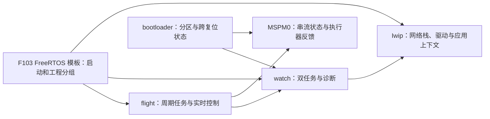

## 六个项目的架构复杂度

六个项目把不同的资源和状态交给了明确的入口。下面的箭头表示可以按所需能力阅读的顺序。各仓的实际开发时间与这种阅读顺序可以不同。

理解复杂度时可同时看四件事。第一个是并发上下文之间的交接，第二个是消息边界及所有权，第三个是跨复位记录，第四个是仪器能直接验证的输出。使用 RTOS 的项目各自有任务职责与预算，裸机工程同样要处理协议、时限和状态转换。

## 能力矩阵

| 工程 | MCU | 调度模型 | 总线或数据入口 | 持久化与失效边界 | 对照入口 |
| --- | --- | --- | --- | --- | --- |
| [[freertos-beginer|FreeRTOS 学习模板]] | STM32F103C8 | 声明 CMSIS-RTOS2，任务源缺失 | Keil 分组声明驱动 | 公开证据为启动文件、RTE 与工程配置 | [[task-and-bus-ownership|任务与所有权]] |
| [[flight|飞控与遥控]] | STM32F103 | 两端 RTOS，飞行 2 tick，射频轮后延时 | I2C1、SPI2 RF、TIM2 PWM、ADC | 空闲校零、断联及 PID 重置 | [[sensor-feedback-pipeline|反馈链]]、[[ADR-0002-assign-sensor-bus-owner|总线所有权]] |
| [[watch|F411 手表]] | STM32F411CEU6 | LVGL 与 sensor，RTC/BT 分阶段推进 | 软件 I2C、SPI DMA、USART1、ADC | EEPROM 双记录槽、WDG1、采样时效 | [[TS-0002-watch-startup-latency|冷启动排障]] |
| [[bootloader|Bootloader]] | STM32F407VE + STM32F103 | 启动分流与应用主循环 | CAN、USART DMA、SPI Flash、EEPROM | 外部先暂存，片内单 APP，加独立恢复 | [[ADR-0001-stage-image-before-boot|暂存决策]]、[[TS-0001-bootloader-update-phase|升级排障]] |
| [[mspm0g3507|K230 平衡]] | MSPM0G3507 + K230 | SysTick 与裸机主循环、串口 ISR | UART0 视觉、UART1 电机、UART3 调参 | 校验、帧龄、回中、驱动故障锁存 | [[TS-0004-k230-vision-timeout|视觉超时排障]] |
| [[iwip|F407 以太网]] | STM32F407ZG | FreeRTOS 与 lwIP 核心、网卡、应用线程 | RMII、MDIO、DMA、FSMC、软件 I2C | pbuf 池回收，静态地址或 DHCP 回退 | [[ADR-0003-run-lwip-in-rtos-mode|OS 模式]]、[[TS-0003-ethernet-link-without-ip|分层排障]] |

## 跨项目可以复核的机制

| 要解决的事 | 两处实现证据 | 对照时应问什么 |
| --- | --- | --- |
| 接收所有权 | watch 的 UART RX 环与 Iwip 的 RX pbuf 池 | 何时交给消费者，消费完成能否延迟复用 |
| 周期和延迟 | flight 的两拍点策略与 watch 的 sensor/LVGL | 固定间隔、轮后延时和器件内部转换各是多少 |
| 状态提交 | bootloader 先正文后标记，与 watch 双槽写回 | 掉电或读回失败后从哪个已有记录恢复 |
| 失效与恢复 | MSPM0 的合法无球/断流，与 Iwip 的 link/IP | 是数据不可用、消息断流，还是底层未连 |
| 输出证据 | flight 的 CCR、MSPM0 已命令位置、Iwip 的数据包 | 写入成功与物理结果之间要观察哪些事件 |

## 按阅读目标选路线

### RTOS 并发线

1. 从 [[freertos-beginer|F103 工程配置]] 追 Cortex-M 启动时钟、异常向量和 RTOS port，列出缺少的应用证据。
2. 用 [[flight|两端任务表]] 计算 2 ms 姿态预算，以射频任务比较 `vTaskDelayUntil` 与 `vTaskDelay`，定位高优先级等待。
3. 用 [[watch|sensor 与 LVGL]] 对比独占、低频轮询、状态快照和 ISR 通知，再到 [[iwip|netif 输入]] 追 pbuf 生命周期和核心邮箱。
4. 按 [[task-and-bus-ownership|任务专题]] 记录任务开始、结束、外设回调和快照发布，得到实际最坏占用与周期抖动。

### 协议与升级线

1. 从 [[embedded-stream-framing|串流专题]] 定义传输边界、语法、业务有效和老化条件。
2. 跟踪 [[bootloader|CAN 更新]] 的 1 s 转移与独立 CRC，复核 5120 B 缓冲和 480 KiB 分区的不同边界。
3. 对照 [[ADR-0001-stage-image-before-boot|持久化决策]]，画出正文、元数据、标记与片内擦写顺序，再用 [[TS-0001-bootloader-update-phase|升级排障]] 验证最后成功阶段。
4. 对照手表 EEPROM 双槽记录怎样保留上个副本，并用 [[ethernet-link-and-ip|网络分层]] 区分传输成功、地址可用及服务响应。

### 控制与排障线

1. 在 [[flight|飞控]] 读一个轴的两级 PID，逐列记录测量单位、符号、输出限幅与 PWM 通道。
2. 在 [[watch|手表]] 追磁力计 X/Z/Y 读取、EEPROM 恢复和失效降级，从 [[TS-0002-watch-startup-latency|启动诊断]] 学板端时间差。
3. 在 [[mspm0g3507|MSPM0]] 手算像素偏差到毫度再到脉冲的倍率，核对命令与真实回执。
4. 按 [[TS-0004-k230-vision-timeout|视觉排障]] 分别做有效帧、无球帧、停发和 PA13 模式，记录输出是保持、回中还是停止。

## 证据口径

> [!NOTE]
> 工程档案以各自固定提交为事实基线。专题中的 C 片段是通用骨架。它们的命名、失败策略和调度条件由相应项目逐一验证。

| 证据 | 可确认 | 下一层证据 |
| --- | --- | --- |
| 固定 SHA 源码 | 配置、调用、状态和用到的常量 | 工程清单确认哪些文件进入构建 |
| 主机测试 | 在给定桩和输入下的逻辑行为 | 目标编译、链接与内存布局 |
| 固件构建 | 编译器、目标地址、产物与链接符号 | 实板引脚、时序和响应 |
| 仪器与运行记录 | 采样率、收发时序、供电、掉电或实物动作 | 复现条件、样本范围及版本 |

阅读时从问题对应的入口向下走一层，记录能观察到的信号，然后用另一个项目的同类机制检查结论是否能复用。

<!-- HUMAN-NOTES:START -->
## 个人复盘与后续思考
（由人工补充与维护）
<!-- HUMAN-NOTES:END -->
