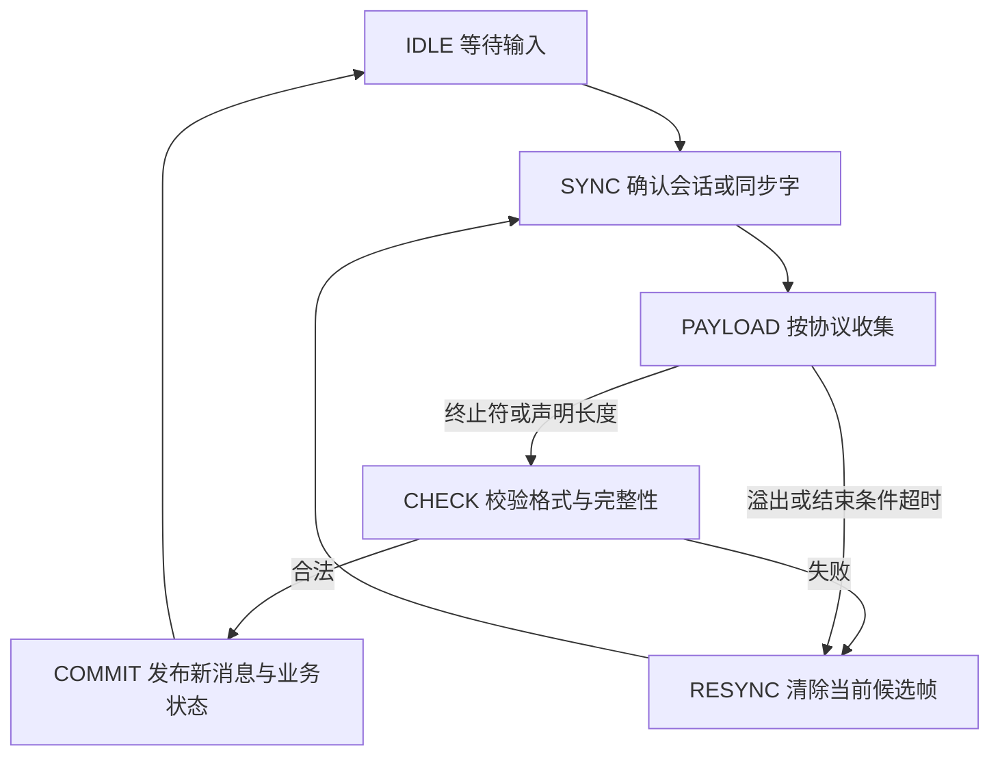

## 问题本质与适用边界

UART DMA 回调、蓝牙通知包和 CAN 报文各自带有传输边界。升级镜像、控制坐标或 AT 回复由应用协议定义，接收端须先完成组帧、再校验，最后决定发布什么状态。同一 CAN ID 可以承载数据帧和独立的校验帧，判别依赖当前会话阶段。

| 状态层 | 条件 | 示例 |
| --- | --- | --- |
| 传输完成 | 一段字节或一帧已进缓冲 | DMA 回调、UART FIFO、CAN DLC |
| 语法完整 | 帧头、字段、帧尾及长度范围满足 | 看到 `$`、逗号、`#` 后成功解析 |
| 业务有效 | 消费者可以用它执行对应操作 | 有球坐标、完整 BIN 的 CRC 匹配 |
| 超时失效 | 从最近一次合格事件起的时限已到 | K230 回中、CAN `verify` 回空闲、AT 启动失败 |

合法无球消息会更新链路新鲜度及业务有效位。不能用 `valid` 代替最近合法帧时刻，否则实物移出画面和 UART 断线会被计成同一种现象。

## 核心机制模型



明确每个计时器刷新事件。CAN BIN 的空闲时钟只由有效数据帧更新，AT 回复截止时间由查询阶段启动，视觉新鲜度由主循环消费合法帧时登记。对同一帧多次重入时，发布动作仅在检查通过后发生。

## 跨项目实现对比

| 项目 | 片段来源 | 消息结束与校验 | 超时和重同步 |
| --- | --- | --- | --- |
| [[bootloader|F407 CAN 更新]] | 标准 ID 1，DLC 1–8 | BIN 先结束，再接 ID 1/DLC 4 的小端 CRC | 1 s 无有效数据后切状态，2 s 等不到 CRC 则回空闲 |
| [[bootloader|F407 USART 恢复]] | `USART1` DMA 环形接收 | `start:len` 给长度，等 `Flash erased; send data` 后发原始 BIN | 长度、2 s 空闲、多余数据和错误标记形成收尾 |
| [[mspm0g3507|MSPM0 UART0]] | RX 中断 → 128 B 环 → 主循环 | `$cx,cy#`，范围检查；无球帧同样符合语法 | 内嵌 `$` 重新同步，超长及环溢出丢候选，150 ms 未消费新帧则回中 |
| [[watch|KT6368A]] | `USART1` RX 完成中断 → 1024 B 环 | 阶段式 AT 查询匹配期望前缀；SPP 诊断有自己的头、类型和 CRC | AT 查询预算 500 ms；环满时丢最旧字节，诊断端按帧协议恢复 |

对应 [CAN 分阶段接收](https://github.com/Mangta517/bootloader/blob/6d5aebc586133f383908581183b44e6572b7be06/stm32f407vet6led/application/app_update.c)、[恢复命令](https://github.com/Mangta517/bootloader/blob/6d5aebc586133f383908581183b44e6572b7be06/stm32f407vet6reset/application/app_reset.c)、[视觉串流](https://github.com/Mangta517/MSPM0G3507/blob/d0232ccc9a7e31693e8fa0d1f234f242cd282856/interface/bsp_uart0_proto.c)、[蓝牙 UART 与 AT](https://github.com/Mangta517/watch/blob/fbd89280178acf4a51e80f919e7f96468b4967f0/interface/kt6368a.c)。

## 可复用模式与常见反模式

示例适合分隔符互斥的文本协议。生产者写入单生产者/单消费者环形队列，消费者串行推进候选帧和超时。`publish_message` 负责记录新的协议时间及业务有效位。若协议允许二进制载荷出现任意字节，则应使用明确的长度或转义语义。

```c
typedef struct
{
    uint8_t collecting;
    uint16_t used;
    uint8_t data[64];
} frame_parser_struct;

void frame_poll(frame_parser_struct *parser)
{
    uint8_t byte;
    message_struct msg;

    if (rx_ring_take_overflow())
    {
        parser->collecting = 0;
    }
    while (rx_ring_pop(&byte))
    {
        if (byte == '$')
        {
            parser->used = 0;
            parser->collecting = 1;
        }
        else if (parser->collecting && byte == '#')
        {
            if (frame_check(parser->data, parser->used, &msg) == 0)
            {
                publish_message(&msg, board_now_ms());
            }
            parser->collecting = 0;
        }
        else if (parser->collecting)
        {
            if (parser->used < sizeof(parser->data))
            {
                parser->data[parser->used++] = byte;
            }
            else
            {
                parser->collecting = 0;
            }
        }
    }
}
```

消费者用消息年龄门限判断旧业务状态是否还能使用。使用同一时钟的无符号差计算短时窗口。环队列由平台实现 ISR/任务同步，溢出发生在消费期间时，需要按该环队列约定中止当前候选并等待下个同步点。

| 容易出现的设计问题 | 后果 | 核对方法 |
| --- | --- | --- |
| 以每次 RX 通知作为帧终止 | 分包乱码、粘包读漏 | 对每个字节位置拆帧并重放 |
| 用任何数据更新有效时限 | 无关 ID 或噪声维持旧目标 | 只用满足当前状态条件的事件刷新 |
| 组帧时直接写业务对象 | 不完整内容驱动执行器 | 先填候选结构，通过检查后发布 |
| 独立 CRC 和 BIN 使用同一缓存 | 长度、CRC 双重偏差 | 用时间窗和独立 DLC 检查验证态 |

## 系统化验证用例

| 测试输入 | 注入点 | 观察 | 预期 |
| --- | --- | --- | --- |
| 合法帧逐字节拆分 | 任意 ISR、DMA 或通知边界 | 发布计数、字段 | 只发布一次，字段一致 |
| 两个帧紧邻 | 连续输入，中间无串口 `IDLE` | 每次解析结果 | 两个语法完整事件可先后识别 |
| 超长和环溢出 | 越过缓存上限后立即发新合法帧 | 错误计数、重同步 | 旧候选作废，下一帧可用 |
| 字段乱码/出界 | 有完整起止符 | `fresh`、最近成功时刻 | 时钟不刷新，不覆盖上次合法记录 |
| 合法无球连发 | 先发有效，再连发无球 | `fresh`、`valid`、帧龄 | 链路继续推进，业务无球 |
| CAN CRC 太早/太晚 | 相对最后数据帧扫边界 | BIN 长度与状态转换 | 只有 `verify` 窗口内的独立 CRC 参与比较 |
| 静止后恢复 | 停发跨超时边界再发正确帧 | 无效动作、首帧处理 | 按各应用策略回中、回空闲或恢复接收 |

对照 [[TS-0001-bootloader-update-phase|CAN 与串口恢复排障]]、[[TS-0004-k230-vision-timeout|视觉无球及超时定位]] 的日志和信号记录验证。

<!-- HUMAN-NOTES:START -->
## 个人复盘与后续思考
（由人工补充与维护）
<!-- HUMAN-NOTES:END -->
