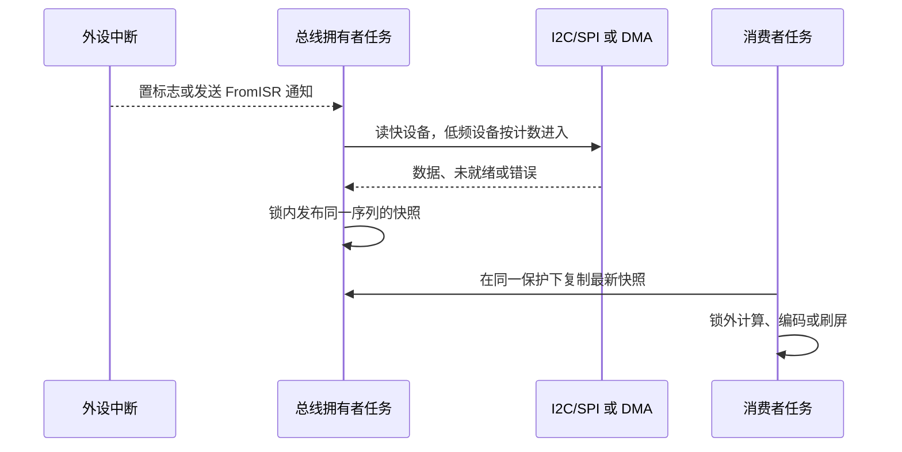

## 问题本质与适用边界

把共享外设的调用权交给一个执行上下文，可以集中检查总线时序、驱动状态和错误恢复。传感器任务需要同时满足更快器件的采样窗口、低频事务的耗时，以及 UI 或控制侧一致读取状态的需求。需要另外定义数据所有权，才能避免消费者读到不同采样序列的混合字段。

一次 I2C 读包含驱动执行、线速、设备等待和超时。任务周期只规定何时尝试开始。驱动用 HAL 阻塞读取时，更高优先级任务仍可抢占，原任务本轮的完成时刻继续受总线故障与调度影响。SPI DMA 则会在调用返回后继续占用缓冲，归属转移发生在完成回调或明确处理的失败路径。

## 核心机制模型



短临界区处理内存交接。驱动调用、等待外设、计算和显示排在保护区外，避免最大事务耗时连带阻塞消费者。若数据生产采用 DMA，开始提交后缓冲保持可访问，完成回调通知所有者复用。引用计数路径等待最后一个消费者释放才归还池。

## 跨项目实现对比

| 项目 | 所有者与拍点 | 交接原语 | 容易混淆的观测 |
| --- | --- | --- | --- |
| [[flight|STM32 飞控]] | 飞行任务独占 `I2C1`，2 tick，SPL006 每 3 拍 | 遥控器输入有 mutex；飞控侧读取 `volatile` 结构的局部副本 | 固定 2 ms 唤醒计划与实际执行起点；飞控侧副本仍可能被发布方抢占 |
| [[watch|F411 手表]] | `sensor` 独占共享 SENSOR I2C，10 ms，气压每 25 拍 | IMU 快照 mutex；`PB12` EXTI 置位，SPI 完成由 DMA ISR 告知显示层 | EXTI 边沿、驱动读成功、UI 消费和首帧完成分别计 |
| [[iwip|F407 以太网]] | `eth_thread` 消费中断唤醒，`eth_link` 100 ms 轮询 | RX/TX 二值信号量、核心邮箱、自定义 `pbuf` 回收 | RX/Tx 完成事件和最后引用释放分别约束缓冲 |
| [[freertos-beginer|F103 学习工程]] | 工程声明 RTOS port 和板级依赖 | 仅可见工程分组与启动向量 | 缺 `freertos.c`、`FreeRTOSConfig.h`，实际任务资源归属待补证 |

固定证据可从 [飞控任务](https://github.com/Mangta517/flight/blob/8b05c39baa1731cf4873d2caaa0db34a61b63e2c/flight_hal/MDK-ARM/application/application_freertos_task.c)、[手表任务](https://github.com/Mangta517/watch/blob/fbd89280178acf4a51e80f919e7f96468b4967f0/application/app_task.c)、[快照保护](https://github.com/Mangta517/watch/blob/fbd89280178acf4a51e80f919e7f96468b4967f0/application/app_imu.c)、[网络驱动](https://github.com/Mangta517/Iwip/blob/eb966f2289c240fd18d5b670aea3057d5f73e3f8/Middlewares/Iwip/arch/ethernetif.c) 与 [F103 工程清单](https://github.com/Mangta517/freertos-beginer/blob/88e3c2fa9133c614d937a5e172fbd0aabd3204b8/01_freertos_template.uvprojx)进入。

## 可复用模式与常见反模式

下例是教学骨架。ISR 只负责报告设备就绪。任务负责事务、分频与发布时间。`snapshot_mutex` 同时用于两个任务，在调度器已启动并建立互斥量后使用。

```c
typedef struct
{
    uint32_t sample_ms;
    uint32_t seq;
    int16_t axis[3];
    int32_t pressure_pa;
    uint8_t motion_valid;
    uint8_t pressure_valid;
} sensor_snapshot_struct;

static sensor_snapshot_struct s_latest;

void sensor_task(void *arg)
{
    TickType_t wake = xTaskGetTickCount();
    sensor_snapshot_struct next = {0};
    uint8_t baro_div = 0;

    for (;;)
    {
        next.motion_valid = read_motion(next.axis);
        next.sample_ms = board_now_ms();
        if (++baro_div >= 25)
        {
            baro_div = 0;
            next.pressure_valid = read_pressure(&next.pressure_pa);
        }
        next.seq++;
        xSemaphoreTake(snapshot_mutex, portMAX_DELAY);
        s_latest = next;
        xSemaphoreGive(snapshot_mutex);
        vTaskDelayUntil(&wake, pdMS_TO_TICKS(10));
    }
}

void sensor_snapshot_read(sensor_snapshot_struct *out)
{
    xSemaphoreTake(snapshot_mutex, portMAX_DELAY);
    *out = s_latest;
    xSemaphoreGive(snapshot_mutex);
}
```

示例的 `read_*` 返回有效标志。气压字段跨多个 IMU 拍保留，消费者需要独立的气压年龄时应再携带它自己的更新时间。使用 tick 换算，记录应用预算时应核对 `pdMS_TO_TICKS` 的取整行为。

| 反模式 | 可能后果 | 修正位置 |
| --- | --- | --- |
| 多任务直接对同一 HAL I2C 句柄发起事务 | 句柄忙、重试风暴、器件状态混杂 | 将事务交给唯一拥有者，或用有限时间的资源锁 |
| 低优先级持锁读器件，高优先级等待 | 中优先级持续抢占时形成优先级反转 | 缩短锁区，确需共享时核对 mutex 优先级继承 |
| ISR 拿长锁，在持锁区等待完成中断 | ISR 不能按任务方式阻塞，可能死锁 | ISR 使用允许的 `FromISR` 原语，只登记或唤醒 |
| 仅用 `volatile` 标记跨字段快照 | 多字段来源于不同帧 | 使用共同的短锁、队列按值发布或其他明确同步 |
| DMA 提交后立即写入同一发送区 | 线上可能出现新旧帧混合 | 以完成归还或独占描述符确认生命周期 |

## 系统化验证用例

| 场景 | 试验条件 | 观测点 | 通过条件 |
| --- | --- | --- | --- |
| 正常负载 | 独立 GPIO 标记任务入/出 | 起点间隔、事务窗口、临界区时间 | 高低频周期与配置关系可复核 |
| 同拍叠加 | 在气压拍同时刷新界面或射频 | 任务实际执行时间、抖动、错过 deadline 次数 | 最坏值落在该应用的预算内 |
| I2C 故障 | 设备不应答或时钟拉低 | 返回耗时、错误计数、下一成功帧时间 | 实测最大阻塞可解释，错误与过期数据可区分 |
| 数据一致性 | 快照填入共用递增标记，持续抢占 | 序号与各字段对应关系 | 消费者同批字段来自一次发布 |
| DMA 池耗尽 | 暂时保留接收引用 | 分配失败、最后一次释放和重新收包 | 有界释放后恢复，归还前无缓冲重用 |

用逻辑分析仪测线速和超时，用固件时间戳统计任务间隔和高水位。预算设置详见 [[ADR-0002-assign-sensor-bus-owner|传感器总线所有权决策]]，网络缓冲演练见 [[ethernet-link-and-ip|以太网接收路径]]。

<!-- HUMAN-NOTES:START -->
## 个人复盘与后续思考
（由人工补充与维护）
<!-- HUMAN-NOTES:END -->
