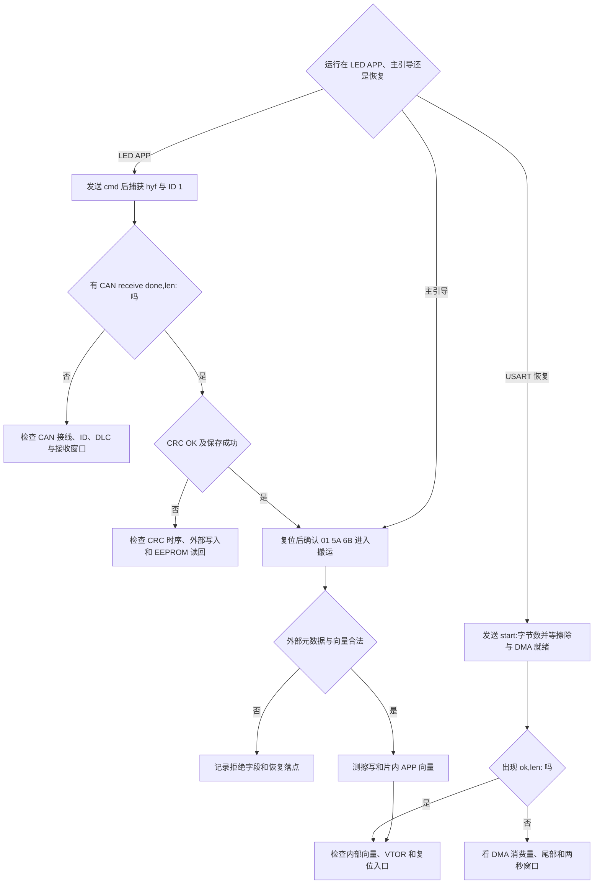

## 典型现象与触发条件

CAN 已触发更新但复位后仍运行旧 APP，主引导启动后直接进入恢复，或者串口恢复打印长度后仍无法跳转。先确认正在运行的 Keil 目标。USART 的 `cmd` 属于 LED APP；`start:len` 属于 F407 恢复程序或单独启用的 F103 装载流程。

| 复现记录 | 应记录的内容 |
| --- | --- |
| 当前镜像 | 对应 F407 目标、APP 链接基址、原始 BIN 字节数 |
| 触发与电源 | `cmd`、`KEY1`、`start:实际字节数` 或上电复位 |
| 传输 | CAN ID/DLC、最后有效帧与 CRC 时间；USART 命令和原始数据长度 |
| 持久化 | W25Q16 的 8 B 元数据和正文首 8 B，EEPROM 的三字节状态 |
| 结果 | 最后一条板端日志、实际复位后的运行目标 |

## 错误原因与触发机理

- **公开联调记录。** 更新 APP 把首个 4 KiB 扇区留给元数据，正文从 W25Q16 的 `0x001000` 写入。实板仍运行扇区 0 的旧主引导，其预检要求 `8 <= start < 0x1000`，读到首扇区以外的正文地址便返回失败，尚未擦除片内 APP。修正提交把起点下限设为 `APP_W25_START_ADDR_MIN=0x001000`，使两个目标遵循同一布局。[修正提交 ca2c823](https://github.com/Mangta517/bootloader/commit/ca2c82397ee94ce1d8c30de2ac03003b6797d058)
- **更早的接收问题。** 逐帧阻塞打印会干扰 F407 轮询接收节拍。早期联调版取消了接收期间的逐帧打印，改在空闲后汇总长度。此时的长度日志只表示统计到的字节数。[历史提交 957ea1f](https://github.com/Mangta517/bootloader/commit/957ea1fbb9615138a5fd2659dd68efa763e85647)
- **固定源码的其他分支。** `app_update_save_image` 拒绝 2048 B 及以下的镜像，未打包的 1360 B 单灯 APP 即使 CRC 正确也会在保存阶段失败。首次读到无效 EEPROM 密钥时，主引导写入 `01 5A 6B`，当次 RAM 中的默认 `02` 保留，下一次启动再读取有效标记。若 BIN 链接基址错误或首 8 B 已损坏，故障会落在外部候选向量预检或片内最终跳转校验。

## 定位过程与关键证据

1. 公开记录依次出现 `CAN receive done,len:4480`、`CRC OK` 和 `Update save OK`。长度与发送端一致，CRC 通过，更新 APP 也完成了外部写入与 EEPROM 标记读回，排查转向复位后的主引导。
2. 复位后首先出现 `APP metadata error: W25=0x00001000 length=4480`。两个值正是新版 APP 写入的起点和长度。在 `App_bootloader_check_meta` 中，该日志位于候选向量读取及片内擦除之前。对照修正提交，`4480` 满足长度约束，`0x001000` 正好触及旧版起点上界，由此锁定主引导与更新 APP 的布局失配。
3. 公开记录记载更新主引导后用户反馈问题解决。记录范围覆盖串口日志及结果反馈，EEPROM 完成标记独立读回、整段 Flash 内容比对和掉电恢复仍需复测。[固定快照中的联调记录](https://github.com/Mangta517/bootloader/blob/6d5aebc586133f383908581183b44e6572b7be06/README.md#L192-L200)
4. 若复测出现 `APP stack pointer error`、`APP reset handler error`，读取 W25Q16 候选 BIN 的首 8 B；若已经完成搬运或串口恢复刚输出 `ok,len:`，再遇到 `Invalid stack pointer` 或 `Invalid reset handler`，读取片内 APP 的首 8 B 并核对 map 的 `0x08008000` 链接基址。

## 具体排查流程

### 故障定位决策树

### 分步排查与速查表

| 阶段 | 观测点与日志关键字 | 正常基线 | 异常根因 | 修复与复测 |
| --- | --- | --- | --- | --- |
| 接收与 CRC · 触发 | `USART1` `cmd`；总线上 `hyf` | 标准 ID 0 / DLC 3 | 命令错工程、接收未置空闲态 | 识别当前工程，重新上电从空闲开始 |
| 接收与 CRC · 长度 | `CAN receive done,len:` | ID 1、DLC 1–8，末帧后 1000 ms 打印字节数 | 位速率、接线、超 5120 B、无有效帧 | 双方 200 kbit/s，验证终端、ACK 和最后两帧 |
| 接收与 CRC · 校验 | `CRC OK` 或 `CRC FAIL` | 末帧后 1100 ms 发 ID 1/DLC 4 小端 CRC；最后数据后 2000 ms 超时 | 提前混进 BIN、超时、尾字补法不同 | 核对捕获时间和实际长度，再用主机脚本算 CRC |
| 外部 Flash 暂存 | `Update save OK` 或 `Update save FAIL` | 2049–5120 B，先写正文再写元数据，最后提交标记 | 短镜像、SPI 写使能、`BUSY`、页边界或标记读回失败 | 测第一处失败，读 W25Q16 与 EEPROM 实值 |
| EEPROM 提交 | `0x10–0x12` 实际三字节 | `01 5A 6B` 更新，成功后 `02 5A 6B`，`03 5A 6B` 恢复 | WP、电源或密钥无效 | 核对每字节，记录两次启动 |
| 片内 Flash 搬运 · 预检 | `APP metadata error`、`APP stack pointer error`、`APP reset handler error` | `0x1000 <= start < 0x200000`，`0x800 < len <= 0x78000`，不越出 W25Q16 | 主引导版本、地址或长度错误，候选 BIN 向量错误 | 解码两个 `LE32`，读正文首 8 B 并核对链接地址 |
| 片内 Flash 搬运 · 擦写 | `APP update error; enter recovery` 或 `APP update ok: length=` | 从扇区 2 擦到 BIN 末字节所在扇区；按 512 B 批次写半字 | 供电、HAL 擦写失败、外部读超时 | 记失败偏移、擦写返回值和引导落点 |
| 向量跳转 | `Error: Invalid stack pointer in application!`、`Error: Invalid reset handler in application!` 或 `jump error` | `MSP` 8 B 对齐，Thumb 复位入口在目标分区 | BIN 用错链接地址、向量已损坏 | 比对 map、片内首 8 B、`VTOR` 和程序实际落点 |

若当前运行串口恢复程序，先发送 `start:len`（1–491520 B），等 `Flash erased; send data` 后发送原始 BIN。按声明长度、DMA 下标和末字节时间定位 `RX error; reset`；若出现 `ok,len:`，按表中「向量跳转」继续检查。

## 关键源码测点

| 路径 | 函数或变量 | 捕获内容 |
| --- | --- | --- |
| [CAN 接收 APP](https://github.com/Mangta517/bootloader/blob/6d5aebc586133f383908581183b44e6572b7be06/stm32f407vet6led/application/app_update.c) | `app_update_state`、`can_rx_len`、`app_update_save_image` | `verify` 转移、CRC 与外部提交时刻 |
| [CAN 发送端](https://github.com/Mangta517/bootloader/blob/6d5aebc586133f383908581183b44e6572b7be06/STM32F103CAN/appliaction/app_update.c) | `send_offset`、帧间和 CRC 等待 | 最后一帧数据和 CRC 的时间差 |
| [启动状态机](https://github.com/Mangta517/bootloader/blob/6d5aebc586133f383908581183b44e6572b7be06/stm32f407vet6/application/app_bootloader.c) | `bootloader_check_update_status`、`w25_app_start_addr`、`app_size_bytes` | 密钥、更新标志、外部元数据、片内擦写 |
| [向量跳转](https://github.com/Mangta517/bootloader/blob/6d5aebc586133f383908581183b44e6572b7be06/stm32f407vet6/interface/int_bootloader.c) | `app_stack_ptr`、`app_reset_handle`、`SCB->VTOR` | 目标地址与是否完成交接 |
| [恢复状态机](https://github.com/Mangta517/bootloader/blob/6d5aebc586133f383908581183b44e6572b7be06/stm32f407vet6reset/application/app_reset.c) | `boot_state`、`uart1_rx_app_len`、`uart1_rx_full_len`、`uart1_rx_complete_tick` | 声明、接收、空闲、收尾与异常复位 |

向量检查时，最终 APP 分区上界为 `0x08080000`，恢复分区上界为 `0x08008000`。初始 `MSP` 必须在 `(0x20000000,0x20020000]` 或 `(0x10000000,0x10010000]`。复位地址为 Thumb，且在所选入口基址加 8 字节至分区上界前。外部候选预检以上次暂存的真实镜像长度作为复位字上界。

## 验证闭环与边界

1. 正常 CAN 样本从 `cmd` 开始，关联总线捕获、暂存内容和 EEPROM 提交，最后记录复位后 APP 入口。
2. 分别模拟缺 CRC、串口短发和错向量。先确认错误归属到 `verify`、DMA 收尾或跳转，再用正确样本复测。
3. 台架掉电测试需分别在暂存、标记、擦除、写入和清标记边界执行。保留独立恢复镜像与有线调试手段。
4. 恢复验证先记录命令及声明长度，等 `Flash erased; send data` 后才送 BIN，最后核对 `ok,len:` 和实际 APP 入口。

> [!WARNING] 升级各阶段的验证边界
> `CRC OK` 验证 CAN 传输，`Update save OK` 验证外部提交，`APP update ok` 指示片内写入流程结束。最终需由向量、实际启动和实验记录确认。

相关机制见 [[ADR-0001-stage-image-before-boot|镜像暂存决策]]、[[embedded-stream-framing|串流组帧]]。

<!-- HUMAN-NOTES:START -->
## 个人复盘与后续思考
（由人工补充与维护）
<!-- HUMAN-NOTES:END -->
