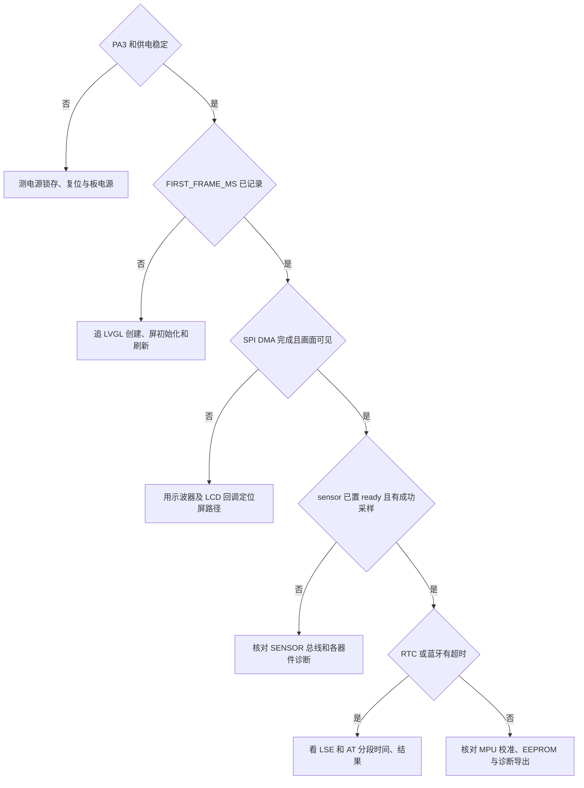

## 典型现象与触发条件

[[watch|F411 手表]] 上电时背光亮但画面延后，画面正常却无传感数据，或初次启动时蓝牙/RTC 比采样晚完成。另一种情况是姿态值到达但零偏尚在收敛。分别记录板端启动时钟和手机侧接收时钟，以当次固件的 WDG1 和仪表测点作为基线。

| 现场条件 | 记录项 |
| --- | --- |
| 启动方式 | 冷启动或复位，RTC 备份域是否保留 |
| 电源 | PA3 自保持的上升沿和供电稳定时间 |
| 屏幕 | 背光、首次 SPI 总线活动、DMA flush 完成及可见画面 |
| 传感器 | EEPROM 是否有有效校准，手表是否保持静止 |
| 蓝牙 | 配置是否已匹配，手机何时建立 SPP、CSV 是否丢帧 |

## 错误原因与触发机理

以下分支来自固定提交的启动代码和诊断文档，可分别解释画面、采样和校准三种延迟。

- **画面延迟。** `app_lvgl_task` 在 `lv_refr_now(NULL)` 返回后立即记录 `FIRST_FRAME_MS`，接着创建 sensor 任务。像素由 SPI1 TX 的 DMA2 Stream2 异步发送，`HAL_SPI_TxCpltCallback` 推进 flush 完成。首帧提交、末个刷屏块发送完成和面板显像各有独立的测量时刻。
- **RTC 与蓝牙晚就绪。** LVGL 循环运行 LSE 及 AT 状态机，传感器任务可并行。LSE 以 `LSERDY` 判断起振，等待上限为 5000 ms。KT6368A 有 20 ms 放电、1200 ms 上电等待和每次查询 500 ms 应答窗口。配置变化还可能触发模块重启和再次查询。[LSE 配置](https://github.com/Mangta517/watch/blob/fbd89280178acf4a51e80f919e7f96468b4967f0/Core/Inc/stm32f4xx_hal_conf.h) [AT 时序定义](https://github.com/Mangta517/watch/blob/fbd89280178acf4a51e80f919e7f96468b4967f0/interface/kt6368a.h)
- **姿态迟迟未稳定。** BL24C02 的两槽 `MPU1` 记录都无效时（空白、量程不符或 CRC 不通过），sensor 任务进入运行期静止采样校准。有有效副本时进入 `MPU6050_CAL_RESTORED` 并立即应用零偏。运行期校准期间，传感器仍可能发布尚未应用本次零偏的数据。

## 定位过程与关键证据

1. 先记录 PA3、VDD 与 NRST。供电锁存和复位均正常后，再把首次 SPI 活动、末个首帧 DMA 完成回调及可见画面标在同一条测量时间轴上。若 `FIRST_FRAME_MS` 已写入而 SPI 迟迟未完成，转查 LCD flush、DMA 配置与回调。若所有像素已发完仍未显像，继续检查面板侧。
2. 使用编译时设置 `APP_DEBUG_TELEMETRY=1` 的诊断固件，从 SPP 导出 WDG1 type 4 的 16 个启动字段。固定提交默认值为 `0`，板端调试可改读内存中的测点。[诊断开关与字段](https://github.com/Mangta517/watch/blob/fbd89280178acf4a51e80f919e7f96468b4967f0/application/app_diag.h)
3. 以同次启动的 `HAL_GetTick()` 为时基，剔除 `0xFFFFFFFF` 未置字段，再求 `SENSOR_READY_MS - SENSOR_BEGIN_MS`、`RTC_END_MS - RTC_BEGIN_MS` 和 `BT_END_MS - BT_BEGIN_MS`。若采样已开始，且各器件成功计数在增长，RTC 或蓝牙的长等待可单独归到对应后台模块。通过 `RTC_RESULT`、`BT_RESULT` 与 `LSERDY`、USART1 波形辨别等待成功与超时。
4. 若采样稳定却仍有零偏，读 `CAL_STATE` 与 `CAL_RESULT`。状态为恢复时直接检查载入记录和姿态；出现静止或平均阶段时核对帧计数；结果为 `2` 时，本次 RAM 校准已成功，按 type 5 的保存阶段与错误码定位 EEPROM 写入或读回失败。实际各段耗时由复测填入。

## 具体排查流程

### 故障定位决策树

### 分步排查与速查表

| 阶段 | 观测点与日志 | 正常基线 | 异常根因 | 处理 |
| --- | --- | --- | --- | --- |
| 供电锁存 | PA3、VDD、复位 | PA3 在板级初始化前拉高 | 自保持接线、电压下跌 | 共时钟量 PA3、VDD、NRST |
| 首帧提交 · 创建任务 | `App_Task_Create`、`App_Display_Init` | 优先级 3、1024 字栈，正常进入任务 | 分配失败、板级初始化阻塞 | 看错误入口、堆和控制流 |
| 首帧提交 | `FIRST_FRAME_MS` | `lv_refr_now` 返回后记录 | 屏初始化、刷屏路径阻塞 | 单独量函数入出时刻 |
| DMA 完成与可见刷新 | DMA2 Stream2、`HAL_SPI_TxCpltCallback` / flush 回调 | 每块传输完成后调用对应回调；一帧可能含多个块 | SPI、DMA 配置或无完成回调 | 同看时钟、片选、回调与可见变化 |
| 采样就绪 · 初始化 | `SENSOR_BEGIN_MS`、`SENSOR_READY_MS` | 首帧提交后创建任务，初始化流程走完后记 ready | I2C 事务、EEPROM 读取、分配 | 按 SDA/SCL 和驱动返回定位 |
| 采样就绪 · 正常采集 | `SAMPLING_BEGIN_MS` 与各 sensor 记录 | 循环开始后逐器件出现有效读数 | 未就绪、NACK、循环延迟 | 比较成功数、样本年龄和采样间隔 |
| 后台模块与校准 · RTC | `RTC_BEGIN_MS`、`RTC_END_MS`、`RTC_RESULT` | LSE 就绪后完成配置；等待上限 5000 ms | LSE 未起振或时钟配置失败 | 查 LSERDY、电源、晶振与负载 |
| 后台模块与校准 · 蓝牙 | `BT_BEGIN_MS`、`BT_END_MS`、`BT_RESULT` | 20 ms 放电、1200 ms 上电等待、每次查询 500 ms 窗口 | 模块供电、UART、AT 未匹配 | 抓 PA8 和 USART1，核对 T4/T5 |
| 后台模块与校准 · MPU | `CAL_STATE`、`CAL_FRAMES`、`CAL_STABLE_FRAMES`、`CAL_RESULT` | 有效记录立即恢复，否则按静止及平均阶段累计 | 板子在动、I2C 失败、记录无效 | 平放重启并核对 CAL 开始/结束 |
| 后台模块与校准 · 保存 | WDG1 type 5 与 `CAL_RESULT` | 成功态 `0`，校准失败 `1`，RAM 成功保存失败 `2` | WP、地址/页边界、写后读回 | 先确认写入阶段与地址，再断电复测 |

设备基线不同。MPU 周期目标 10 ms，SPL006 每 250 ms 轮询 1 Hz 器件，AHT21 约 2 s 一次，心率开启后软件最低读间隔 30 ms。`SAMPLING_BEGIN_MS` 表示进入服务循环，首包应从各项的成功计数与首样本时间证据确认。

## 关键源码测点

| 路径 | 测点 |
| --- | --- |
| [启动入口](https://github.com/Mangta517/watch/blob/fbd89280178acf4a51e80f919e7f96468b4967f0/Core/Src/main.c) | `POWER_EN`、创建任务前各 `MX_*_Init` |
| [任务启动](https://github.com/Mangta517/watch/blob/fbd89280178acf4a51e80f919e7f96468b4967f0/application/app_task.c) | `lv_refr_now` 后登记 `FIRST_FRAME_MS`；紧接 `xTaskCreate(sensor)` |
| [LCD SPI](https://github.com/Mangta517/watch/blob/fbd89280178acf4a51e80f919e7f96468b4967f0/interface/lcd.c) | `LCD_Color_Fill_DMA`、`HAL_SPI_TxCpltCallback`、flush 完成回调 |
| [字段定义](https://github.com/Mangta517/watch/blob/fbd89280178acf4a51e80f919e7f96468b4967f0/application/app_diag.h)、[打包服务](https://github.com/Mangta517/watch/blob/fbd89280178acf4a51e80f919e7f96468b4967f0/application/app_diag.c) | 启动 16 槽，发送 `WDG1`，字段和序号小端 |
| [RTC 服务](https://github.com/Mangta517/watch/blob/fbd89280178acf4a51e80f919e7f96468b4967f0/interface/watch_rtc.c)、[AT 推进](https://github.com/Mangta517/watch/blob/fbd89280178acf4a51e80f919e7f96468b4967f0/interface/kt6368a.c) | LSE 与 AT 等待、完成状态 |
| [EEPROM 记录](https://github.com/Mangta517/watch/blob/fbd89280178acf4a51e80f919e7f96468b4967f0/application/app_imu_store.c)、[保存细分状态](https://github.com/Mangta517/watch/blob/fbd89280178acf4a51e80f919e7f96468b4967f0/docs/imu-eeprom.md) | 双副本恢复、量程、CRC、保存读回 |

启动字段的时间戳都是板端 HAL 毫秒。差值如 `BT_END_MS - BT_BEGIN_MS` 采用 32 位无符号计算，先排除 `0xFFFFFFFF` 未置值。RTC 和蓝牙结果按 HAL 返回值判断，MPU 状态和结果按应用枚举。若需区分零偏恢复是否已完成，结合 `CAL_STATE` 和 type 5 保存阶段，避免把未执行保存解释为失败。

## 验证闭环与边界

1. 在静止且固定接线条件下重复冷启动，保留同一 SHA、首次通电和后续上电的区别。
2. 以示波器或逻辑分析仪记录 VDD、PA3、LCD SPI。标记 LVGL 开始、首帧提交、各 DMA 完成和首张画面的可见时刻。
3. 用启用诊断的固件从 SPP 导出启动、任务、传感器、MPU EEPROM 和校准记录，对同一次板端时间轴做差。
4. 分别以已有有效 EEPROM 与需要校准的状态复测；临时遮断蓝牙或 RTC 时观察传感器是否继续采集。
5. 连接手机后确认帧序号及 CRC。采样成功、UART 发送成功和手机接收分别观察。

> [!WARNING]
> 需实板/仪器验证边界。没有 DMA、可见首帧或所有器件首有效样本的内置启动字段，可加仪器触发或临时测点。实际缩短量以同一硬件多次冷启动的分布为准。

[旧启动流程与测量口径](https://github.com/Mangta517/watch/blob/fbd89280178acf4a51e80f919e7f96468b4967f0/docs/startup-optimization.md)、[当前诊断协议及 CSV](https://github.com/Mangta517/watch/blob/fbd89280178acf4a51e80f919e7f96468b4967f0/docs/diagnostics.md)及 [[sensor-feedback-pipeline|传感反馈链与校准状态]]。

<!-- HUMAN-NOTES:START -->
## 个人复盘与后续思考
（由人工补充与维护）
<!-- HUMAN-NOTES:END -->
