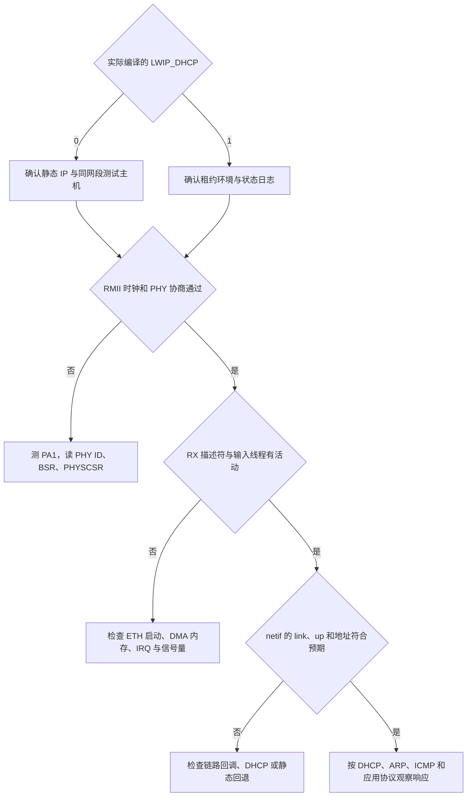

## 典型现象与触发条件

交换机与 PHY 指示灯显示已接线，开发板却无租约、无 ARP 回复或 ping 不通。默认静态固件使用 `192.168.1.30/24`，接入的测试 PC 需使用同网段未占用地址。只有实际编入 DHCP 路径时才预期出现租约申请。

| 初始记录 | 需要的证据 |
| --- | --- |
| 固件和模式 | SHA、Keil 目标、`LWIP_DHCP`、`[NET] Mode:` 日志 |
| 物理链路 | 开发板、交换机端口、线缆和 PA1 时钟 |
| 测试网络 | PC 网卡、IP/掩码、VLAN、是否有 DHCP 服务器 |
| 快照变量 | MDIO 地址、PHY 协商结果、`g_lwipdev`、`g_lwip_netif` |
| 包级证据 | 同一时间窗口的 ARP、ICMP 和可选 DHCP 抓包 |

## 故障定位决策树

## 分层排查速查表

| 阶段 | 观测点与日志 | 正常基线 | 异常根因 | 处理 |
| --- | --- | --- | --- | --- |
| 构建模式 | `LWIP_DHCP`、`[NET] Mode: Static` 或 `[NET] Mode: DHCP` | 默认 0，IP `192.168.1.30`、掩码 `255.255.255.0`、网关 `192.168.1.1` | 错误固件、主机网段错误 | 对照 Keil 宏与开机日志 |
| 启动 | `[ETH] lwIP(FreeRTOS) init ok`、`g_lwip_init_status` | 初始成功可以无链路 | PHY 初始化失败或分配失败 | 对照 `lwip_comm_init failed` 及重试 |
| 参考时钟 | PA1 50 MHz、PHY nRST、MDC/MDIO | PHY 输出 RMII REFCLKO，稳定复位释放 | 时钟方向错误、复位未释放 | 用板级地测示波器波形 |
| PHY | ID1 `0x0007`，ID2 mask `0xFFF0` 得 `0xC0F0` | BSR `0x01` link 位，PHYSCSR `0x1F` 有协商结果 | MDIO 地址、连线、协商未完成 | 读扫描结果、对端端口及速率双工 |
| RX 路径 | `HAL_ETH_ReadData`、ISR、`eth_thread` 和描述符 OWN | 收包 IRQ 可唤醒线程；pbuf 由核心终止引用 | DMA 地址进 CCM、池耗尽、接口未启动 | 在 ISR、信号量、PBUF 分配/回收处记计数 |
| netif | `netif_is_link_up` / `netif_is_up` / IPv4 | link 与 up 各有标志，静态地址按配置 | MAC 配置失败、链路状态未更新 | 检查 `HAL_ETH_Start_IT` 与 link callback |
| DHCP | `[NET] DHCP IP:` 或 `[NET] DHCP timeout, static IP:` | 模式开启时申请；`tries>4` 走静态回退 | 服务器、广播隔离、包未送栈 | 判断四步中断位置，用实际分到的 IP |
| ARP / ICMP | ARP Request/Reply，再看 Echo | 同网段应先解析 MAC，后有应答 | 地址冲突、回包路径、主机防火墙 | 对照两端抓包及 PC 邻居缓存 |
| 服务 | 实际业务端口、Netconn 编译选项 | 有监听者后才有应用响应 | 地址已通但服务未启用 | 用服务端日志和 TCP 连接对照 |

当前源码里 `LWIP_STATS=0`。统计 RX 时用调试器或临时插桩区分中断、`ReadData` 成功、`netif->input` 错误和池释放，自定义调试计数与 lwIP 原生统计分开记录。

## 关键源码测点

- [编译配置](https://github.com/Mangta517/Iwip/blob/eb966f2289c240fd18d5b670aea3057d5f73e3f8/Middlewares/Iwip/arch/lwipopts.h)确认 OS 模式、DHCP 和校验开关。
- [PHY 识别与链路](https://github.com/Mangta517/Iwip/blob/eb966f2289c240fd18d5b670aea3057d5f73e3f8/Drivers/BSP/ETHERNET/ethernet_chip.c)查看 MDIO 扫描、BCR reset、BSR 读取和 PHYSCSR 速率双工。
- [输入和链路状态](https://github.com/Mangta517/Iwip/blob/eb966f2289c240fd18d5b670aea3057d5f73e3f8/Middlewares/Iwip/arch/ethernetif.c)查看 `ethernetif_link_check_state`、`ethernetif_input` 与 `pbuf_free_custom`。
- [地址状态机](https://github.com/Mangta517/Iwip/blob/eb966f2289c240fd18d5b670aea3057d5f73e3f8/Middlewares/Iwip/arch/lwip_comm.c)查看 `lwip_link_status_updated`、`lwip_dhcp_process`、`g_lwipdev` 和 `g_lwip_netif`。
- [网络启动与应用并行](https://github.com/Mangta517/Iwip/blob/eb966f2289c240fd18d5b670aea3057d5f73e3f8/application/app_task.c)查看 `start_task` 的多次尝试及触摸任务是否仍运行。

## 验证闭环与边界

| 抓包顺序 | 过滤方式 | 应看到的现象 |
| --- | --- | --- |
| DHCP 模式先确认租约 | `udp.port == 67 or udp.port == 68` | Discover、Offer、Request、ACK；无租约时对照超时回退 |
| IP 已确定后看 ARP | `arp` | PC 求指定 IP，目标以对应 MAC 回答 |
| 邻居解析后看 ICMP | `icmp and ip.addr == 192.168.1.30`，替换为实际 IP | Echo Request/Reply，结果与发起主机一致 |
| 存在业务服务时看端口 | `tcp.port == 端口号`，代入数值 | 连接握手和服务响应各自明确 |

链路刚恢复时先确认 PHY 返回 10/100 Mbit/s 与预期双工，再核对 MAC 配置。BSR 的链路状态需要按驱动的读取方式解释，协商未完成先等待下一个 100 ms 链路检查。

在 PC 侧记录 `Get-NetNeighbor -AddressFamily IPv4` 和 `ping` 结果。若交换机隔离流量，按需要从能看到广播和目标单播的位置抓包。插拔线缆复测链路、地址与恢复后首次应答，并在触摸并发负载下复测。

> [!WARNING]
> 需实板/仪器验证边界。link LED 亮只提供物理线索，完整连通性按 PHY、DMA、接口、地址和协议响应逐层证实。

通过标准为同一测试轮中记录成功的 ARP 和 ICMP，DHCP 固件另需解释租约或回退后的地址来源。

对照 [[ethernet-link-and-ip|以太网分层模型]] 与 [[ADR-0003-run-lwip-in-rtos-mode|lwIP OS 模式决策]]。

<!-- HUMAN-NOTES:START -->
## 个人复盘与后续思考
（由人工补充与维护）
<!-- HUMAN-NOTES:END -->
