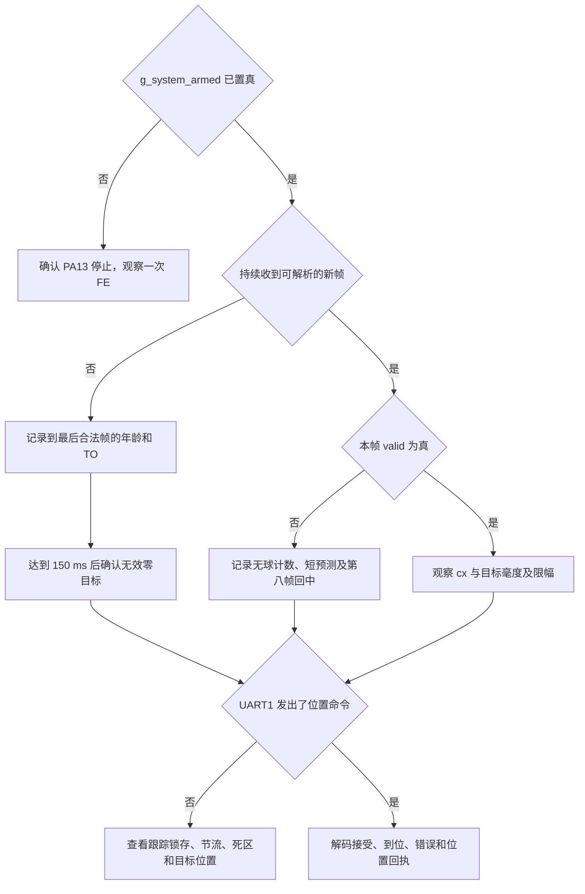

## 典型现象与触发条件

摆杆保持、回中或停机，K230 却仍有画面。画面、串口收发、控制有效和电机实际到位分别观察。[[mspm0g3507|MSPM0G3507 平衡工程]] 默认启动后武装，排障要同时记录按键时序、视觉数据、控制目标与 Emm_V5 回执。

| 状态 | 输入例子 | 初步验证 |
| --- | --- | --- |
| 有目标 | `$410,260#` | `fresh=1, valid=1`，产生新控制量 |
| 持续无球 | `$-1,-1#` 连发 | `fresh=1, valid=0`；最近接收时刻继续刷新 |
| UART0 断流 | 停发送达到 150 ms，或只有坏帧 | 无合格新帧，超时设置无效零目标 |
| PA13 停止 | PA13 从高到低 | `g_system_armed=false`，进入一次性停止 |
| 驱动故障 | Emm 回 `E2` 或 `EE` | 锁存故障并发送停止，需明确重新武装 |

## 错误原因与触发机理

- **合法无球帧触发回中。** UART0 解析 `$-1,-1#` 后发布 `fresh=1, valid=0`。武装主循环仍刷新 `g_k230_last_rx_ms`，并累计 `s_ball_miss_cnt`。短时可以预测或保持，第 8 个连续无球帧会清 PID 和历史，并设为无效零目标。
- **UART0 断流或持续坏帧也触发回中。** 武装期间距最后一次消费合法帧达到 150 ms，`g_k230_timeout` 置真并调用 `StepperTrack_SetTarget(0, false)`。下一条合法帧清除超时标志，后续动作由该帧的目标有效性决定。
- **解除武装、驱动故障和发包节流会表现为无动作。** PA13 下降沿使系统解除武装，主循环发送一次 `FE` 停止。Emm_V5 对已知命令的合法 `E2/EE` 回复会使 `StepperTrack_Update` 锁存 `fault` 并停止，后续视觉帧不能清除锁存，需排除故障后按 PA12 重新武装。无锁存时也可能因为目标仍在死区，或运动中偏差较小且距上次发包不足 10 ms，而暂不发新命令。[节流与死区定义](https://github.com/Mangta517/MSPM0G3507/blob/d0232ccc9a7e31693e8fa0d1f234f242cd282856/application/app_stepper_track.h)

## 定位过程与关键证据

1. 抓 UART0 原始流并记录帧间隔。若 `$-1,-1#` 仍持续出现且解析后帧龄不断刷新，可排除本轮断流，转查 K230 的检测结果或 ROI。若字节存在但无 `fresh`，核对组帧、坐标范围与溢出计数。
2. 同时记录 `SM[ARM]` / `SM[OFF]`。武装状态下用调试器或临时测点读取 `s_ball_miss_cnt` 和 `g_k230_last_rx_ms`。计数达到 8、帧龄仍在刷新是无球路径。帧龄达到 150 ms 且 `TO` 置位是超时路径。200 ms 的无线调试打印可能跨过超时边沿，按 UART0 采样时间和板端 `tick_ms` 定位触发点。
3. 比较 `ang: tgt=` 的毫度与 `stp: tgt=` 的脉冲，再检查 UART1 是否实际发出 `FD` 位置帧。有目标变化但无帧时，读取 `g_track.fault`、最后发包时刻与目标差值，确认锁存、节流或死区分支。
4. 对齐 UART1 命令与原始回执。`02` 只表示命令被接受，`9F` 表示驱动器报告到位，`E2/EE` 对应故障分支。日志的 `stp: cur` 是已命令的脉冲位置。实际角度通过 `0x36` 位置查询回包或外部测量确认。此定位顺序来自固定提交，实际台架结果需逐轮记录。

## 具体排查流程

### 故障定位决策树

### 分步排查与速查表

| 阶段 | 观测点与日志 | 正常基线 | 异常根因 | 处理 |
| --- | --- | --- | --- | --- |
| 系统武装 | PA12、PA13 下降沿，`SM[ARM]` / `SM[OFF]` | PA13 解除武装并发一次 `FE`，PA12 重武装 | 停止后尚未重新武装、按键异常 | 看引脚电平和实际停机帧 |
| UART0 新帧 · 视觉 | K230 画面、ROI、最终 UART 文本 | 有球发 `$cx,cy#`；无球发 `$-1,-1#` | 光照、ROI、检测框中心出界 | 看脚本实际发帧和图像坐标 |
| UART0 新帧 · 线路 | PA10 TX/PA11 RX，115200 bit/s | 合法帧经 ISR 入环，主循环解析 | 接线、共地、位速率、FIFO/环溢出 | 捕获原始字节的起止符与间隔 |
| UART0 新帧 · 组帧 | `g_uart0_data.fresh/valid`、解析错误和溢出计数 | x=0–799、y=0–479，或同时 -1 | 坏字段、中间重置、超长 | 重放一帧确定发布是否发生 |
| 目标有效性与超时 · 无球 | `K230:(-1,-1) ok=0`、`s_ball_miss_cnt` | 合法帧刷新时间，第 8 帧清 PID 和历史并设零目标 | 脱离 ROI 或漏检 | 将帧龄和丢球计数同时记录 |
| 目标有效性与超时 · 断流 | `SM[ARM] ... TO`、`g_k230_last_rx_ms` | 达到 150 ms 设置无效零目标，下一合法帧清超时 | 线断、K230 停帧、持续解析失败 | 核对板端帧龄与坏帧计数 |
| 位置命令 | `ang: tgt=`、`stp: tgt=`、UART1 的 `FD` 帧 | 先算毫度，再算脉冲，按限幅与节流下发 | 方向错、死区、故障锁存 | 核对 PID 输出、目标差值及实际位置帧 |
| 串口回执 · 状态 | UART1 PA8 TX/PA9 RX，`rx=` | `02` 接受；有到位应答时 `9F`；`E2/EE` 故障 | 线路、固件协议不符、到位应答未启用 | 抓原始帧并核对 Emm/X 固件和配置 |
| 串口回执 · 零位 | `boot=` 和 `0x36` 位置应答 | 回读实际角度；无回复显示 `NO`，零点校验失败有 `?` | 电机未回包或装配零点偏离 | 对照绝对坐标和机械参考复测 |

## 关键源码测点

| 路径 | 测点 |
| --- | --- |
| [视觉脚本](https://github.com/Mangta517/MSPM0G3507/blob/d0232ccc9a7e31693e8fa0d1f234f242cd282856/k230_ball_balance.py) | 实际 `uart.write` 前的坐标或无球帧 |
| [UART0 IRQ 与组帧](https://github.com/Mangta517/MSPM0G3507/blob/d0232ccc9a7e31693e8fa0d1f234f242cd282856/interface/bsp_uart0_proto.c)、[历史 K230 接口](https://github.com/Mangta517/MSPM0G3507/blob/d0232ccc9a7e31693e8fa0d1f234f242cd282856/interface/bsp_k230_uart.c) | 当前 FIFO→环→`UART0_Proto_Poll`→`uart0_parse_frame` |
| [主循环](https://github.com/Mangta517/MSPM0G3507/blob/d0232ccc9a7e31693e8fa0d1f234f242cd282856/mian.c) | `g_system_armed`，`s_ball_miss_cnt`，`g_k230_timeout`，`StepperTrack_SetTarget` |
| [角度跟踪](https://github.com/Mangta517/MSPM0G3507/blob/d0232ccc9a7e31693e8fa0d1f234f242cd282856/application/app_stepper_track.c) | `StepperTrack_Update`、`fault`、`target_angle_mdeg`、位置发出点 |
| [驱动协议](https://github.com/Mangta517/MSPM0G3507/blob/d0232ccc9a7e31693e8fa0d1f234f242cd282856/interface/emmv5.c) | `EMMV5_RX_Poll`、`0x36` 定长接收、`0x6B` 帧尾 |

## 验证闭环与边界

1. 用受限台架发送有效坐标，确认 x 方向、目标角度、发出命令与机械回执。
2. 保持 UART 连通，连续发送无球帧，记录年龄刷新、预测窗口与第 8 帧进入回中。
3. 停止发送，从最后一条合格消息起测 150 ms 触发及当前命令，重新送合法帧后观察恢复。
4. 按 PA13，确认发生一次真实停止帧。重武装后单独验证正常位置发包。
5. 记录停止或丢球前后的实际角度与最后一条目标角，确认回中轨迹与急停动作的区别。
6. 检查实际驱动器返回码、到位回执设置及机械零点。用位置读取应答区分已发送目标与实际到位。

> [!WARNING]
> 需实板/仪器验证边界。-1 坐标属于协议认可的无球状态，串口超时设置的是回中目标，PA13 或驱动故障走停机。准确角度、速度、到位时间和保护行为随硬件配置实测。

同一测试使用一致的视野、机械零位和命令限幅，每轮保留首个异常帧、主循环状态和驱动回执。

相关概念见 [[embedded-stream-framing|串流组帧]]、[[sensor-feedback-pipeline|反馈量和执行器换算]]。

<!-- HUMAN-NOTES:START -->
## 个人复盘与后续思考
（由人工补充与维护）
<!-- HUMAN-NOTES:END -->
